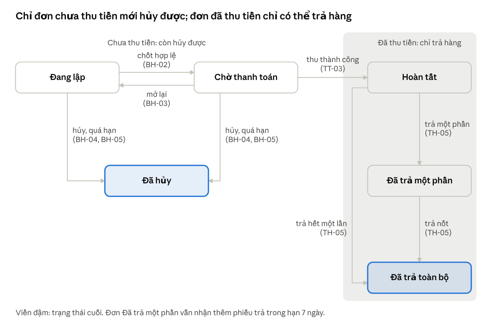
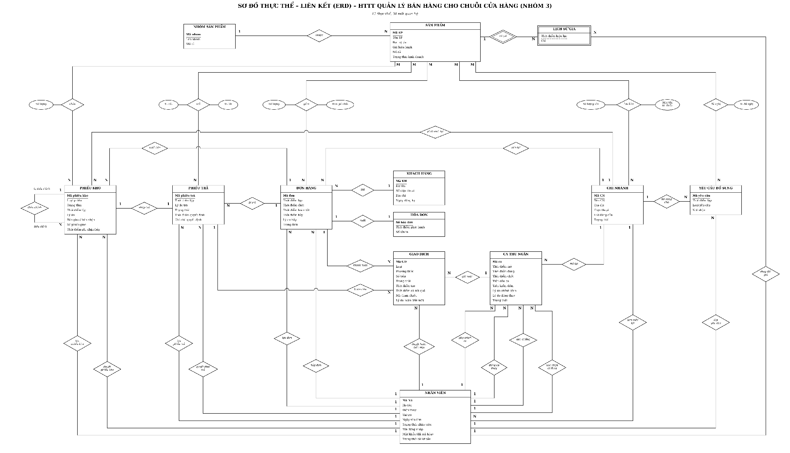
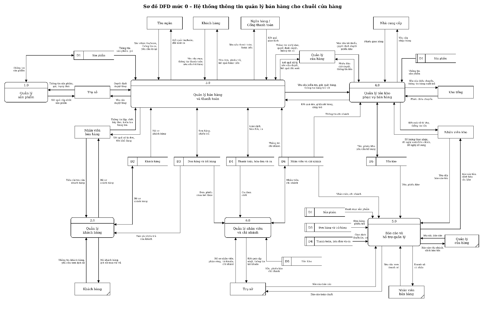
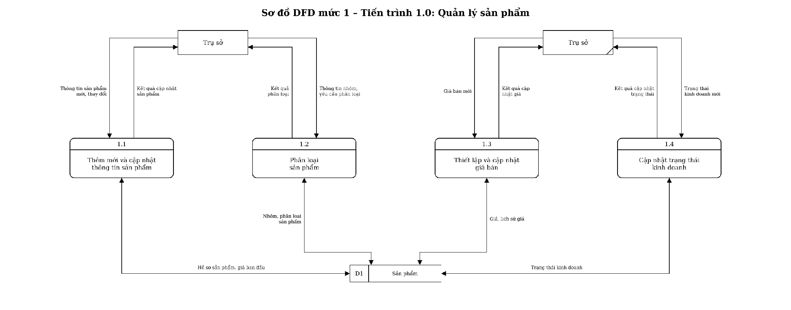
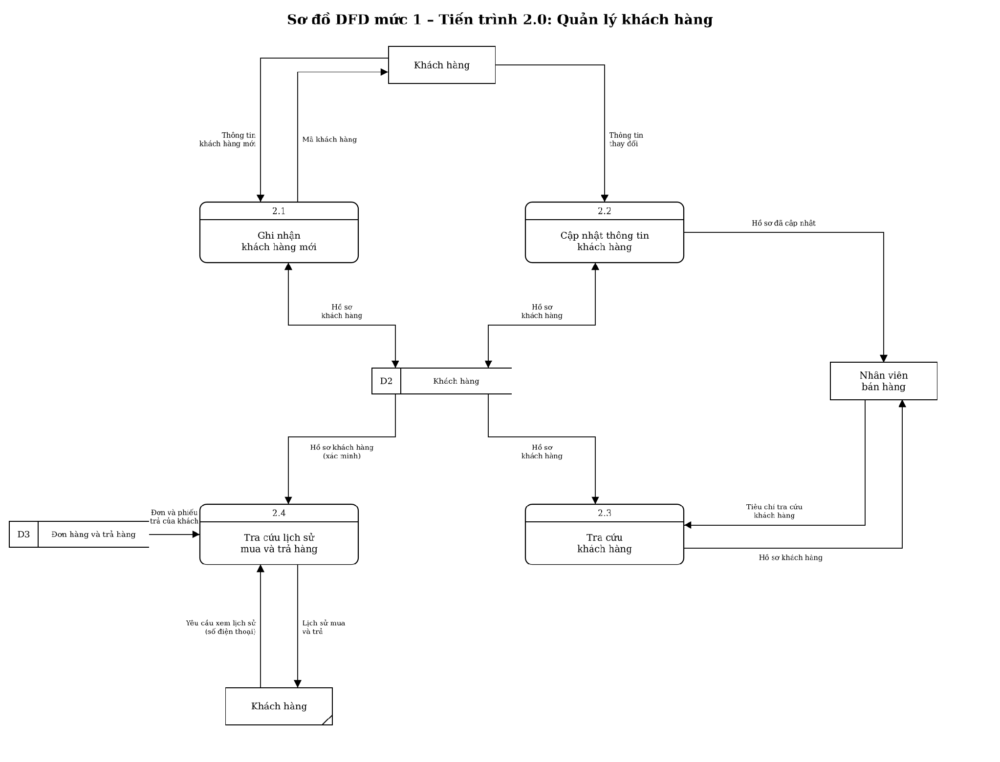
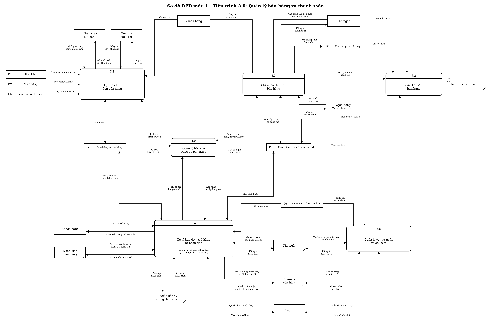
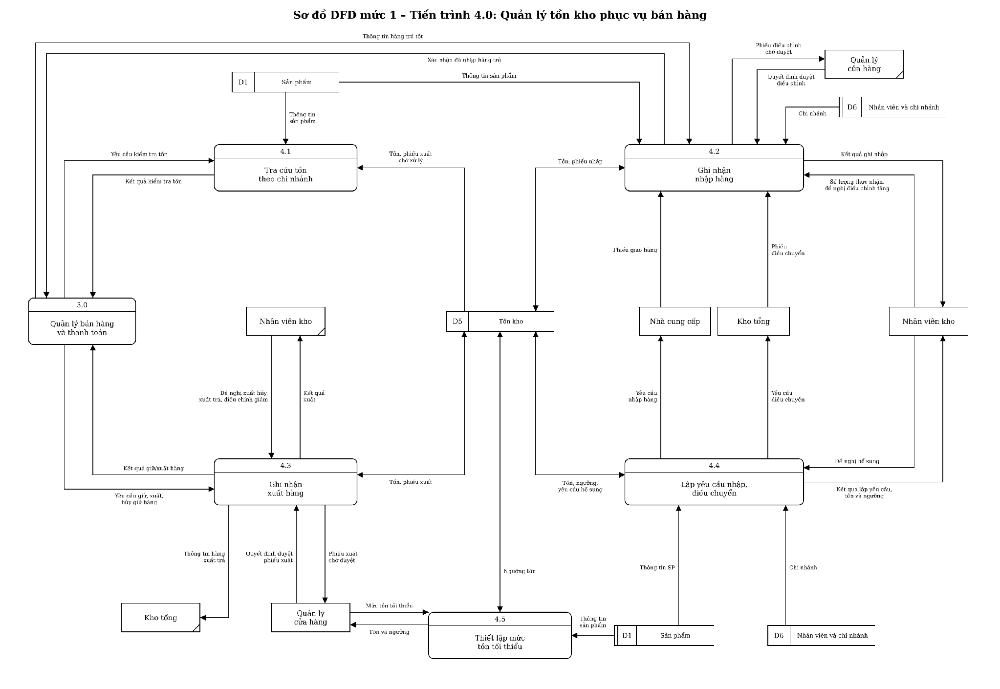
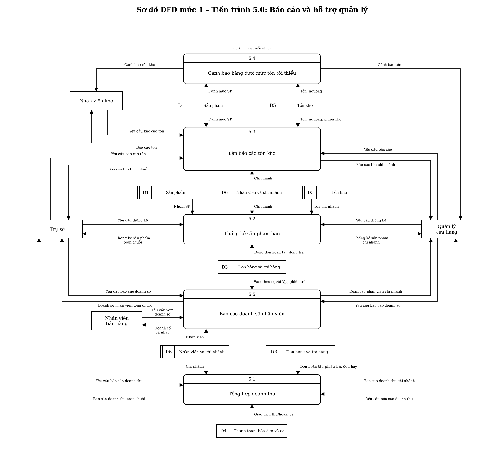
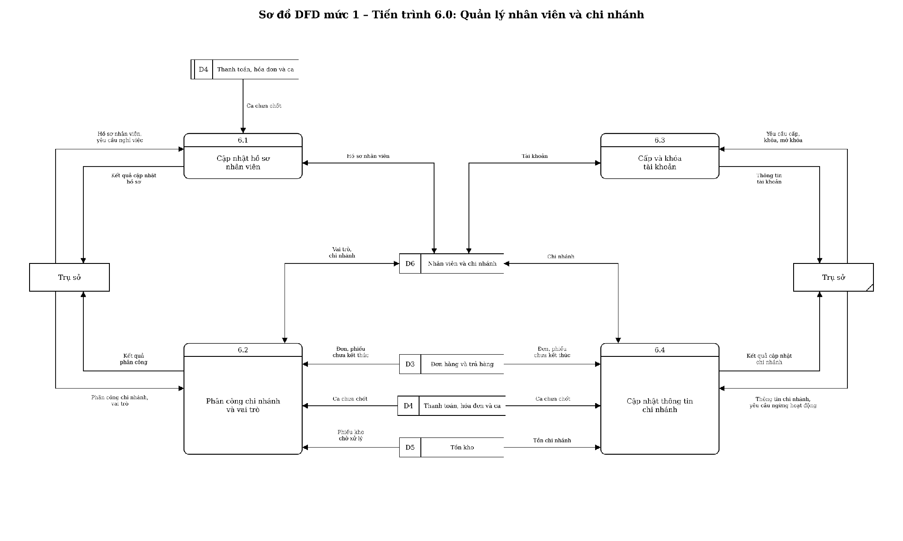

# Đặc tả nghiệp vụ – Hệ thống thông tin quản lý bán hàng cho chuỗi cửa hàng (Nhóm 3)

> Bản Markdown của file Word "Đặc tả nghiệp vụ – HTTT quản lý bán hàng cho chuỗi cửa hàng (Nhóm 3) – Final", chuyển nguyên văn ngày 13/11/2026.
> Đây là nguồn sự thật cao nhất của dự án (xem [README.md](README.md)). Không sửa tay; đổi nội dung thì dùng lệnh `/doc-change`.
> Sơ đồ phân rã chức năng (BFD): [img/bfd.webp](img/bfd.webp).

## 1. Bối cảnh, mục tiêu, phạm vi và giả định

Hệ thống ghi nhận bán hàng, thanh toán, đổi trả và tồn kho tại từng chi nhánh, từ đó cung cấp báo cáo cho trụ sở và quản lý cửa hàng ra quyết định. Bản đặc tả này là cơ sở duy nhất để vẽ DFD mức 0, DFD mức 1 và ERD; mọi thay đổi sau này phải cập nhật đồng thời quy tắc, DFD và ERD.

### 1.1 Bối cảnh

Một chuỗi bán lẻ hàng tiêu dùng gồm trụ sở, nhiều chi nhánh và một kho tổng. Hiện tại mỗi chi nhánh ghi chép riêng nên trụ sở khó tổng hợp doanh thu, không biết tồn từng chi nhánh để điều hàng, và khó kiểm soát tiền tại quầy cũng như việc đổi trả.

### 1.2 Mục tiêu

- Ghi nhận chính xác, không trùng lặp mỗi lần bán, thu tiền, trả hàng và hoàn tiền.
- Theo dõi tồn theo từng chi nhánh, cảnh báo hàng sắp hết.
- Kiểm soát tiền mặt theo ca thu ngân và tách người lập với người duyệt.
- Cung cấp báo cáo doanh thu, sản phẩm, tồn kho và doanh số nhân viên làm căn cứ cho các quyết định nhập hàng, điều chỉnh mặt hàng và đánh giá nhân viên.

### 1.3 Phạm vi trong bài

Hệ thống gồm 6 nhóm và 27 chức năng con, thống nhất với BFD_Nhom3_v2_1. Mã chức năng chỉ thể hiện phân cấp, không quy định thứ tự thực hiện.

| Nhóm chức năng | Chức năng con |
| --- | --- |
| 1. Quản lý sản phẩm | 1.1 Thêm mới và cập nhật thông tin sản phẩm · 1.2 Phân loại sản phẩm · 1.3 Thiết lập và cập nhật giá bán · 1.4 Cập nhật trạng thái kinh doanh |
| 2. Quản lý khách hàng | 2.1 Ghi nhận khách hàng mới · 2.2 Cập nhật thông tin khách hàng · 2.3 Tra cứu khách hàng · 2.4 Tra cứu lịch sử mua và trả hàng |
| 3. Quản lý bán hàng và thanh toán | 3.1 Lập và chốt đơn bán hàng · 3.2 Ghi nhận thu tiền bán hàng · 3.3 Xuất hóa đơn bán hàng · 3.4 Xử lý hủy đơn, trả hàng và hoàn tiền · 3.5 Quản lý ca thu ngân và đối soát |
| 4. Quản lý tồn kho phục vụ bán hàng | 4.1 Tra cứu tồn theo chi nhánh · 4.2 Ghi nhận nhập hàng · 4.3 Ghi nhận xuất hàng · 4.4 Lập yêu cầu nhập, điều chuyển · 4.5 Thiết lập mức tồn tối thiểu |
| 5. Báo cáo và hỗ trợ quản lý | 5.1 Tổng hợp doanh thu · 5.2 Thống kê sản phẩm bán · 5.3 Lập báo cáo tồn kho · 5.4 Cảnh báo hàng dưới mức tồn tối thiểu · 5.5 Báo cáo doanh số nhân viên |
| 6. Quản lý nhân viên và chi nhánh | 6.1 Cập nhật hồ sơ nhân viên · 6.2 Phân công chi nhánh và vai trò · 6.3 Cấp và khóa tài khoản · 6.4 Cập nhật thông tin chi nhánh |

### 1.4 Ngoài phạm vi

Quản lý nội bộ kho tổng; mua hàng, giá vốn, công nợ và danh mục nhà cung cấp; vận chuyển, giao nhận; khuyến mại, giảm giá, tích điểm; bán online, đặt cọc, giữ hàng theo yêu cầu khách; hóa đơn điện tử và kế toán thuế; lợi nhuận; chấm công, tiền lương, chỉ tiêu kế hoạch; bảo hành; điều chuyển trực tiếp giữa hai chi nhánh; quy trình kiểm kê định kỳ (chỉ ghi nhận kết quả điều chỉnh, xem TK-04).

### 1.5 Giả định

Mỗi giả định thu hẹp phạm vi có chủ đích. Mọi quy tắc phía sau được viết dựa trên các giả định này.

| Mã | Giả định | Lý do |
| --- | --- | --- |
| G-01 | Nhân viên bán hàng tư vấn và lập đơn; khách thanh toán tại quầy thu ngân; khách nhận hàng sau khi đơn Hoàn tất. | Tách người bán và người thu tiền để kiểm soát; hàng chỉ rời quầy khi đã thu tiền. |
| G-02 | Giá niêm yết thống nhất toàn chuỗi, đã gồm VAT; không giảm giá, không phụ thu. | Khuyến mại ngoài phạm vi; tránh giá riêng từng chi nhánh. |
| G-03 | Mỗi đơn được thanh toán một lần, đủ tổng tiền, bằng một phương thức: Tiền mặt, Chuyển khoản hoặc Thẻ. | Là trường hợp phổ biến; thanh toán kết hợp nhiều phương thức là hướng mở rộng. |
| G-04 | Thanh toán điện tử được khởi tạo từ phần mềm qua máy POS hoặc mã QR động gắn với đúng một giao dịch; ngân hàng/cổng thanh toán trả kết quả kèm mã tham chiếu. | Khách không thể trả nhiều lần cho cùng một giao dịch; phần mềm chỉ nhận kết quả, không xử lý tiền. |
| G-05 | Hóa đơn là chứng từ bán lẻ in cho khách, ghi tổng tiền đã gồm VAT, không tách tiền thuế. | Hóa đơn điện tử và kê khai thuế ngoài phạm vi. |
| G-06 | Khách hàng dùng chung toàn chuỗi; hàng được trả tại đúng chi nhánh đã bán, trong 7 ngày kể từ khi đơn Hoàn tất. | Trả chéo chi nhánh cần điều chuyển hàng và tiền, ngoài phạm vi. |
| G-07 | Số lượng hàng là số nguyên theo đơn vị tính; tiền tính bằng VND, số nguyên. | Không bán hàng cân ký. |
| G-08 | "Cuối ngày" là giờ đóng cửa của từng chi nhánh, lưu trong thông tin chi nhánh. | Các chi nhánh có thể đóng cửa giờ khác nhau. |
| G-09 | Mỗi đợt giao hàng đến chi nhánh có phiếu giao riêng của kho tổng hoặc nhà cung cấp; hàng chỉ được ghi nhập sau khi kiểm nhận thực tế. | Phần mềm không theo dõi vận chuyển hay giao một phần. |

## 2. Tác nhân, phân quyền và nguyên tắc kiểm soát

Hệ thống có 9 tác nhân: 5 vai trò nội bộ trực tiếp dùng phần mềm và 4 đối tượng bên ngoài. Ranh giới DFD là phần mềm, nên người dùng nội bộ cũng là tác nhân khi họ đưa dữ liệu vào hoặc nhận kết quả.

### 2.1 Danh sách tác nhân

| Tác nhân | Loại | Vai trò trong hệ thống |
| --- | --- | --- |
| Trụ sở | Nội bộ | Quản lý danh mục sản phẩm, giá, nhân viên, tài khoản, chi nhánh; duyệt thay khi quản lý cửa hàng vắng hoặc là người lập; xem báo cáo toàn chuỗi. |
| Quản lý cửa hàng (QL) | Nội bộ | Điều hành một chi nhánh: duyệt trả hàng, duyệt phiếu kho, xác nhận chốt ca, đặt ngưỡng tồn, xem báo cáo chi nhánh. |
| Nhân viên bán hàng (NVBH) | Nội bộ | Tư vấn, lập và chốt đơn, ghi nhận khách hàng, lập phiếu trả. |
| Thu ngân | Nội bộ | Mở và đóng ca, thu tiền, in hóa đơn, thực hiện hoàn tiền. |
| Nhân viên kho (NV kho) | Nội bộ | Kiểm nhận và ghi nhập hàng, lập phiếu xuất khác và điều chỉnh, lập yêu cầu bổ sung. |
| Khách hàng | Bên ngoài | Cung cấp thông tin cá nhân, yêu cầu mua, thông tin thanh toán, yêu cầu trả; nhận hóa đơn, phiếu trả, lịch sử mua. |
| Ngân hàng/Cổng thanh toán | Bên ngoài | Nhận yêu cầu thanh toán/hoàn tiền điện tử; trả kết quả kèm mã tham chiếu. |
| Kho tổng | Bên ngoài | Gửi phiếu giao hàng điều chuyển; nhận yêu cầu bổ sung và thông tin hàng trả về kho tổng. |
| Nhà cung cấp (NCC) | Bên ngoài | Gửi phiếu giao hàng giao thẳng; nhận yêu cầu nhập hàng. |

Quy ước vẽ DFD (để không đếm hai lần một dữ liệu): dữ liệu thuộc về ai thì người đó là nguồn. Thông tin do khách cung cấp (họ tên, số điện thoại, hàng muốn mua, hàng muốn trả) có nguồn là Khách hàng, dù nhân viên là người gõ vào. Quyết định và xác nhận nghiệp vụ (chốt đơn, hủy, duyệt, số lượng thực nhận, tiền kiểm đếm, tình trạng hàng trả) có nguồn là nhân viên ra quyết định. Phiếu giao của Kho tổng/NCC (số phiếu, hàng ghi trên phiếu) và số lượng thực nhận của NV kho là hai dữ liệu khác nhau. Kiểm tra quyền dùng thông tin phiên đăng nhập, không vẽ luồng đọc D6 cho mọi lần kiểm tra quyền.

### 2.2 Ma trận phân quyền

Quyền của QL, NVBH, Thu ngân, NV kho chỉ áp dụng trong chi nhánh hiện tại của họ. "Duyệt thay" chỉ dùng khi QL vắng mặt hoặc QL là người lập/thực hiện, phải ghi lý do.

| Chức năng | Trụ sở | QL | NVBH | Thu ngân | NV kho |
| --- | --- | --- | --- | --- | --- |
| 1.1–1.4 Sản phẩm, nhóm, giá, trạng thái | Có | — | — | — | — |
| 2.1–2.3 Ghi nhận, cập nhật, tra cứu khách hàng | — | — | Có | — | — |
| 2.4 Tra cứu lịch sử mua và trả cho khách | — | — | Có | — | — |
| 3.1 Lập, chốt, mở lại đơn | — | Có | Có (đơn mình lập) | — | — |
| 3.2 Thu tiền; 3.3 In hóa đơn | — | — | — | Có | — |
| 3.4 Hủy đơn chưa thanh toán | — | Có | Có (đơn mình lập) | — | — |
| 3.4 Lập phiếu trả | — | Có | Có | — | — |
| 3.4 Duyệt phiếu trả; duyệt đổi phương thức hoàn | Duyệt thay | Có | — | — | — |
| 3.4 Thực hiện hoàn tiền | — | — | — | Có | — |
| 3.5 Mở ca, đóng ca, nhập tiền kiểm đếm | — | Đóng ca thay (CA-04) | — | Có | — |
| 3.5 Xác nhận chốt ca | Duyệt thay | Có | — | — | — |
| 4.1 Tra cứu tồn (phục vụ 3.1 khi chốt đơn) | Qua 5.3 | Qua 4.5, 5.3 | Qua 3.1 khi lập đơn | — | Qua 4.4, 5.3 |
| 4.2 Ghi nhập từ phiếu giao | — | — | — | — | Có |
| 4.2/4.3 Lập phiếu xuất khác, điều chỉnh | — | — | — | — | Có |
| 4.2/4.3 Duyệt phiếu xuất khác, điều chỉnh | — | Có | — | — | — |
| 4.4 Lập yêu cầu bổ sung | — | — | — | — | Có |
| 4.5 Đặt mức tồn tối thiểu | — | Có | — | — | — |
| 5.1, 5.2 Doanh thu, sản phẩm bán | Toàn chuỗi | Chi nhánh mình | — | — | — |
| 5.3, 5.4 Tồn kho, cảnh báo | Toàn chuỗi (qua 5.3) | Chi nhánh mình | — | — | Chi nhánh mình |
| 5.5 Doanh số nhân viên | Toàn chuỗi | Chi nhánh mình | Của mình | — | — |
| 6.1–6.4 Nhân viên, tài khoản, chi nhánh | Có | — | — | — | — |

Thu ngân xem kết quả ca của mình qua 3.5, không qua nhóm 5. Mỗi chi nhánh có ít nhất một NV kho: NV kho ghi nhập, lập phiếu xuất khác/điều chỉnh và yêu cầu bổ sung; QL chỉ đặt ngưỡng và duyệt phiếu kho, nên không bao giờ tự duyệt phiếu của mình. Hồ sơ khách hàng do NVBH ghi nhận và tra cứu khi lập đơn; thu ngân và QL xem thông tin khách qua đơn hàng (3.0), không thao tác trực tiếp ở nhóm 2.

### 2.3 Nguyên tắc kiểm soát

| Mã | Nguyên tắc |
| --- | --- |
| K-01 | Quyền gắn với vai trò và chi nhánh hiện tại, kiểm tra tại thời điểm thao tác. Tài khoản Bị khóa không thực hiện được thao tác nào. |
| K-02 | Người duyệt phải khác người lập hoặc thực hiện. QL duyệt thông thường; trụ sở duyệt thay khi QL vắng hoặc chính QL là người lập/thực hiện, kèm lý do. Phiếu kho không có duyệt thay (TK-03). |
| K-03 | Mọi quyết định duyệt, hủy, từ chối đều lưu người quyết định, thời điểm và lý do. |
| K-04 | Không sửa, xóa chứng từ đã có hiệu lực (đơn Hoàn tất, hóa đơn, giao dịch có kết quả, phiếu trả đã quyết định, phiếu kho đã ghi nhận, ca đã chốt). Sai sót được xử lý bằng chứng từ mới có duyệt. |
| K-05 | Không xóa danh mục đã phát sinh nghiệp vụ (sản phẩm, khách hàng, nhân viên, chi nhánh); dùng trạng thái ngừng. Chứng từ giữ chi nhánh và nhân viên tại thời điểm phát sinh, không suy lại từ hồ sơ hiện tại. |

## 3. Quy trình nghiệp vụ chính

Năm luồng dưới đây bao trọn nghiệp vụ trong phạm vi; mỗi bước ghi mã chức năng BFD và mã quy tắc ở mục 4. Đây là trình tự nghiệp vụ, không thay cho luồng dữ liệu trên DFD.

### P1. Bán hàng và thanh toán

- NVBH tra cứu khách theo số điện thoại (2.3); khách mới đồng ý cung cấp thông tin thì ghi nhận (2.1); khách không cung cấp thì dùng mã KHLE.
- NVBH lập đơn Đang lập với sản phẩm và số lượng khách chọn (3.1, BH-01).
- NVBH chốt đơn: hệ thống kiểm tra sản phẩm Đang bán, tồn khả dụng đủ (4.1), cố định đơn giá; đơn chuyển Chờ thanh toán (BH-02). Không đạt thì đơn vẫn Đang lập kèm lý do.
- Khách đến quầy. Thu ngân (ca Đang mở) chọn đơn và phương thức khách chọn; hệ thống giữ hàng của đơn (4.3) rồi tạo giao dịch thu Chờ kết quả (3.2, TT-01, TT-02). Giữ hàng bị từ chối do thiếu tồn thì không tạo giao dịch, báo NVBH.
- Kết quả thanh toán: tiền mặt do thu ngân xác nhận; điện tử do ngân hàng trả về (TT-02).
- Thành công: hàng giữ chuyển thành xuất bán (4.3), đơn chuyển Hoàn tất (3.2, TT-03), hóa đơn được phát hành và in cho khách (3.3, TT-04); khách nhận hàng.
- Thất bại: hàng giữ được giải phóng, đơn vẫn Chờ thanh toán; khách có thể thanh toán lại.
- Chưa có kết quả: hàng tiếp tục được giữ, không tạo giao dịch mới, thu ngân tra soát với ngân hàng rồi cập nhật kết quả.

### P2. Khách đổi ý hoặc bỏ đơn trước khi thanh toán

- Khách muốn thêm, bớt hàng khi đơn Chờ thanh toán: người lập mở lại đơn về Đang lập, sửa, chốt lại; giá được cập nhật theo giá hiện hành (3.1, BH-03).
- Khách bỏ mua: người lập hoặc QL hủy đơn, ghi lý do (3.4, BH-04).
- Đơn bị bỏ quên: đến giờ đóng cửa, hệ thống tự hủy với lý do Quá hạn (3.4, BH-05).
- Không mở lại hay hủy được đơn đang có giao dịch Chờ kết quả. Đơn đã Hoàn tất không hủy, chỉ có thể trả hàng (P3). Hủy không làm thay đổi tồn và doanh thu.

### P3. Trả hàng và hoàn tiền

- Khách mang hàng và hóa đơn (hoặc số điện thoại đã đăng ký) đến đúng chi nhánh đã bán trong 7 ngày (TH-01).
- NVBH kiểm tra hàng, ghi số lượng tốt và lỗi, lập phiếu trả Chờ duyệt; hàng vẫn do khách giữ (3.4, TH-02).
- QL (khác người lập) duyệt hoặc từ chối ngay trong ngày; QL vắng hoặc là người lập thì trụ sở duyệt thay (TH-03).
- Từ chối: khách mang hàng về, không thay đổi gì khác.
- Đã duyệt: cửa hàng nhận hàng; hàng tốt được nhập lại tồn (4.2); hàng lỗi không vào tồn; phát sinh nghĩa vụ hoàn đúng giá trị phiếu; đơn chuyển Đã trả một phần/toàn bộ (TH-05).
- Thu ngân hoàn tiền bằng phương thức đã thu của đơn, trong ca Đang mở (TH-04). Hoàn điện tử thất bại thì thử lại; không thể hoàn về phương thức gốc thì QL duyệt hoàn tiền mặt, ghi lý do.
- Phiếu chưa được duyệt đến giờ đóng cửa tự chuyển Từ chối với lý do Quá hạn duyệt; khách có thể quay lại trong thời hạn 7 ngày.

### P4. Ca thu ngân và đối soát

- Thu ngân nhận quỹ tiền lẻ từ QL, mở ca và nhập tiền đầu ca (3.5, CA-01).
- Mọi giao dịch thu và hoàn trong ca mang mã ca đó.
- Hết ca: thu ngân xử lý xong giao dịch tiền mặt đang mở, kiểm đếm, nhập tiền thực có và lý do nếu chênh lệch; ca chuyển Chờ xác nhận (CA-02).
- QL nhận tiền, kiểm tra kết quả đối soát và xác nhận; ca chuyển Đã chốt. Ca còn giao dịch điện tử Chờ kết quả thì chưa chốt được (CA-03).
- Thu ngân vắng đột xuất hoặc bị khóa tài khoản khi ca Đang mở: QL kiểm đếm cùng một nhân viên làm chứng, đóng ca thay; trụ sở xác nhận chốt (CA-04).

### P5. Nhập hàng, bổ sung và điều chỉnh tồn

- QL đặt mức tồn tối thiểu cho sản phẩm kinh doanh tại chi nhánh (4.5).
- Hằng ngày hệ thống cảnh báo sản phẩm có tồn dưới ngưỡng cho QL và NV kho (5.4).
- NV kho lập yêu cầu bổ sung gửi kho tổng hoặc NCC giao thẳng (4.4). Yêu cầu không làm tăng tồn.
- Hàng đến kèm phiếu giao; NV kho kiểm nhận và ghi phiếu nhập theo số lượng thực nhận; tồn tăng (4.2, TK-02).
- Phát hiện sai lệch (nhập nhầm, hàng hỏng, mất) hoặc cần trả hàng về kho tổng: NV kho lập phiếu điều chỉnh hoặc xuất khác Chờ duyệt; QL duyệt thì tồn mới thay đổi (4.2/4.3, TK-03, TK-04).

## 4. Đặc tả chức năng và quy tắc nghiệp vụ

Mỗi nhóm BFD có một bảng chức năng (dùng trực tiếp để vẽ DFD mức 1) và một bảng quy tắc. Cột "Đầu vào" và "Đầu ra" ghi nguồn/đích trước dấu hai chấm; nguồn/đích là mã chức năng khác thì đó là luồng giữa hai tiến trình. Các kho D1–D6 được định nghĩa ở mục 5.

### 4.1 Nhóm 1 – Quản lý sản phẩm (kho D1)

| Mã | Đầu vào | Xử lý chính | Đầu ra | Kho |
| --- | --- | --- | --- | --- |
| 1.1 Thêm mới và cập nhật thông tin sản phẩm | Trụ sở: thông tin sản phẩm mới (mã, tên, nhóm, đơn vị tính, mô tả, giá ban đầu) hoặc thông tin sửa | Kiểm tra mã không trùng, nhóm tồn tại, giá > 0; tạo sản phẩm Đang bán kèm bản ghi lịch sử giá đầu tiên. Khi sửa chỉ đổi tên, mô tả; đơn vị tính chỉ đổi khi chưa phát sinh chứng từ | Trụ sở: kết quả cập nhật hoặc lý do từ chối | Đọc/ghi D1 |
| 1.2 Phân loại sản phẩm | Trụ sở: thông tin nhóm; yêu cầu đổi nhóm của sản phẩm | Tạo, sửa nhóm; gán sản phẩm sang nhóm khác; không xóa nhóm còn sản phẩm | Trụ sở: kết quả | Đọc/ghi D1 |
| 1.3 Thiết lập và cập nhật giá bán | Trụ sở: mã sản phẩm, giá mới | Kiểm tra giá > 0 và khác giá hiện hành; cập nhật giá hiện hành; ghi lịch sử giá (giá, thời điểm hiệu lực, người đổi) | Trụ sở: kết quả | Đọc/ghi D1 |
| 1.4 Cập nhật trạng thái kinh doanh | Trụ sở: mã sản phẩm, trạng thái mới | Chuyển Đang bán ↔ Ngừng bán | Trụ sở: kết quả | Đọc/ghi D1 |

| Mã | Quy tắc |
| --- | --- |
| SP-01 | Mã sản phẩm và mã nhóm duy nhất toàn chuỗi, không đổi sau khi tạo. Mỗi sản phẩm thuộc đúng một nhóm. Không xóa nhóm còn sản phẩm. |
| SP-02 | Giá bán > 0, thống nhất toàn chuỗi, chỉ trụ sở thay đổi, có hiệu lực ngay khi lưu. Mỗi lần đổi giá ghi một bản ghi lịch sử giá. Không có giá theo chi nhánh, không lập lịch giá tương lai. |
| SP-03 | Giá đã chốt trên đơn không đổi khi giá sản phẩm đổi (BH-02); tiền hoàn luôn dùng giá đã chốt (TH-04). |
| SP-04 | Không xóa sản phẩm đã có trên đơn hoặc phiếu kho; dùng trạng thái Ngừng bán. Sản phẩm Ngừng bán không được chốt vào đơn mới và không bị cảnh báo tồn; vẫn được nhận trả, xuất trả kho tổng và xuất hiện trong báo cáo. Sản phẩm mới có tồn 0 tại mọi chi nhánh. |

### 4.2 Nhóm 2 – Quản lý khách hàng (kho D2)

Dữ liệu khách hàng phục vụ ba việc: tìm lại đơn khi khách trả hàng mà mất hóa đơn, cung cấp lịch sử mua cho khách, và cho 5.1 đo tỷ trọng doanh thu của khách có hồ sơ (căn cứ nếu sau này mở chương trình khách hàng thân thiết). Vì vậy chỉ lưu các trường cần cho ba việc này.

| Mã | Đầu vào | Xử lý chính | Đầu ra | Kho |
| --- | --- | --- | --- | --- |
| 2.1 Ghi nhận khách hàng mới | Khách hàng: họ tên, số điện thoại, địa chỉ (tùy chọn) | Chuẩn hóa số điện thoại, kiểm tra trùng; trùng thì trả hồ sơ có sẵn; không trùng thì tạo mã mới, ghi ngày đăng ký | Khách hàng: mã khách hàng | Đọc/ghi D2 |
| 2.2 Cập nhật thông tin khách hàng | Khách hàng: mã khách, thông tin thay đổi | Kiểm tra số điện thoại mới không thuộc hồ sơ khác; cập nhật | NVBH: hồ sơ đã cập nhật hoặc lý do từ chối | Đọc/ghi D2 |
| 2.3 Tra cứu khách hàng | NVBH: số điện thoại hoặc mã khách | Tìm hồ sơ khớp | NVBH: hồ sơ khách hoặc "Không tìm thấy" | Đọc D2 |
| 2.4 Tra cứu lịch sử mua và trả hàng | Khách hàng: yêu cầu xem lịch sử kèm số điện thoại để xác minh | Xác minh đúng chủ hồ sơ; liệt kê các đơn từng Hoàn tất (kể cả đã trả) và phiếu trả kèm trạng thái, mới nhất trước | Khách hàng: lịch sử mua và trả | Đọc D2, D3 |

| Mã | Quy tắc |
| --- | --- |
| KH-01 | Với khách có hồ sơ, họ tên và số điện thoại là bắt buộc; số điện thoại duy nhất toàn chuỗi, kiểm tra trùng khi tạo và khi cập nhật. |
| KH-02 | Khách không cung cấp thông tin dùng mã mặc định KHLE (khách lẻ, không có số điện thoại). Mọi đơn đều có mã khách. Không tra cứu lịch sử cá nhân cho KHLE. |
| KH-03 | Không xóa khách đã có đơn. Sửa hồ sơ không làm thay đổi mã khách và nội dung các đơn cũ. |
| KH-04 | Lịch sử mua chỉ cung cấp cho đúng khách sau khi xác minh số điện thoại. Chỉ thu thập các trường đã nêu trong D2. |

### 4.3 Nhóm 3 – Quản lý bán hàng và thanh toán (kho D3, D4)

Nhóm 3 ghi nhận toàn bộ vòng đời đơn và dòng tiền. Nhờ G-03 (thanh toán một lần) và cơ chế giữ hàng khi thu (TT-03), thu tiền thành công luôn đi kèm xuất bán và Hoàn tất; vì vậy không tồn tại đơn đã thu tiền mà chưa hoàn tất, và hủy đơn không bao giờ phát sinh hoàn tiền.

vòng đời đơn hàng · 6 trạng thái

Ranh giới giữa hai vùng là giao dịch thu Thành công: trước đó đơn chỉ có thể bị hủy (không phát sinh tiền), sau đó chỉ có thể trả hàng. Trạng thái đơn không thay cho trạng thái giao dịch hay tình trạng hoàn tiền của phiếu trả.

| Mã | Đầu vào | Xử lý chính | Đầu ra | Kho |
| --- | --- | --- | --- | --- |
| 3.1 Lập và chốt đơn bán hàng | Khách hàng: yêu cầu mua (sản phẩm, số lượng), mã khách; NVBH/QL: lệnh chốt, yêu cầu mở lại; 4.1: kết quả kiểm tra tồn | Lập, sửa đơn Đang lập; chốt theo BH-02; mở lại theo BH-03 | NVBH: đơn và kết quả chốt hoặc lý do, tồn khả dụng của sản phẩm đang chọn; 4.1: yêu cầu kiểm tra tồn | Đọc D1, D2, D6; đọc/ghi D3 |
| 3.2 Ghi nhận thu tiền bán hàng | Khách hàng: phương thức thanh toán; Thu ngân: đơn cần thu, xác nhận đã nhận tiền mặt, kết quả tra soát; Ngân hàng: kết quả thanh toán; 4.3: kết quả giữ/xuất hàng | Kiểm tra TT-01; yêu cầu giữ hàng; tạo và cập nhật giao dịch thu; khi thành công chuyển đơn Hoàn tất (TT-03) | Ngân hàng: yêu cầu thanh toán; 4.3: yêu cầu giữ hàng, xác nhận xuất, hủy giữ; 3.3: thông tin đơn Hoàn tất; Thu ngân: kết quả thanh toán | Đọc/ghi D3, D4 |
| 3.3 Xuất hóa đơn bán hàng | 3.2: thông tin đơn Hoàn tất; Thu ngân: yêu cầu in lại | Phát hành một hóa đơn cho đơn; in lại dùng số cũ (TT-04) | Khách hàng: hóa đơn | Đọc D3; đọc/ghi D4 |
| 3.4 Xử lý hủy đơn, trả hàng và hoàn tiền | NVBH/QL: yêu cầu hủy kèm lý do, kết quả kiểm tra hàng trả (tốt/lỗi); Khách hàng: yêu cầu trả (mã đơn, sản phẩm, số lượng, lý do); QL/Trụ sở: quyết định duyệt phiếu, duyệt hoàn tiền mặt; Thu ngân: yêu cầu hoàn, xác nhận đã chi tiền mặt; Ngân hàng: kết quả hoàn; 4.2: xác nhận nhập hàng trả; sự kiện đến giờ đóng cửa | Hủy đơn (BH-04, BH-05); lập, duyệt, tự từ chối phiếu trả (TH-01–TH-03); tạo và cập nhật giao dịch hoàn (TH-04); cập nhật trạng thái đơn sau trả (TH-05) | NVBH/QL: kết quả hủy, phiếu cần duyệt, danh sách phiếu chưa hoàn xong; Khách hàng: phiếu trả và kết quả hoàn tiền; Ngân hàng: yêu cầu hoàn; 4.2: thông tin hàng trả tốt | Đọc D6; đọc/ghi D3, D4 |
| 3.5 Quản lý ca thu ngân và đối soát | Thu ngân: yêu cầu mở ca kèm tiền đầu ca, yêu cầu đóng ca kèm tiền kiểm đếm và lý do chênh lệch; QL: đóng ca thay, xác nhận chốt; Trụ sở: xác nhận chốt thay | Mở, đóng, chốt ca; tính tiền mặt kỳ vọng và chênh lệch; lập kết quả đối soát (CA-01–CA-04) | Thu ngân: trạng thái ca, kết quả đối soát; QL/Trụ sở: kết quả đối soát chờ xác nhận | Đọc D6; đọc/ghi D4 |

3.4 gộp ba nghiệp vụ nhỏ; nếu DFD mức 1 quá dày, có thể phân rã mức 2 thành 3.4.1 Hủy đơn, 3.4.2 Xử lý phiếu trả, 3.4.3 Hoàn tiền mà không đổi BFD.

Đơn hàng

| Mã | Quy tắc |
| --- | --- |
| BH-01 | Đơn thuộc chi nhánh nơi lập, do NVBH hoặc QL của chi nhánh đó lập; có đúng một mã khách (có thể là KHLE); có ít nhất một dòng; mỗi sản phẩm một dòng; số lượng nguyên > 0. Tổng tiền đơn = Σ (số lượng × đơn giá chốt), đã gồm VAT, là dữ liệu dẫn xuất. Doanh số ghi cho người lập. |
| BH-02 | Chốt đơn: kiểm tra chi nhánh Hoạt động, mọi sản phẩm Đang bán, số lượng mỗi dòng không vượt tồn khả dụng (4.1); lấy giá hiện hành ghi thành đơn giá chốt; đơn chuyển Chờ thanh toán, ghi thời điểm chốt. Không đạt thì đơn vẫn Đang lập kèm lý do cụ thể. Chốt không giữ hàng. Giá đổi hoặc sản phẩm chuyển Ngừng bán sau khi chốt không ảnh hưởng đơn đã chốt. |
| BH-03 | Chỉ sửa nội dung khi đơn Đang lập. Đơn Chờ thanh toán không có giao dịch Chờ kết quả có thể được người lập hoặc QL mở lại về Đang lập; khi chốt lại, giá và tồn được kiểm tra lại theo BH-02. |
| BH-04 | Chỉ hủy đơn Đang lập hoặc Chờ thanh toán không có giao dịch Chờ kết quả. NVBH hủy đơn mình lập, QL hủy được mọi đơn của chi nhánh; ghi người hủy, thời điểm, lý do. Hủy không làm đổi tồn, doanh thu và không phát sinh hoàn tiền. Đơn đã Hoàn tất không được hủy, chỉ được trả hàng. |
| BH-05 | Đến giờ đóng cửa của chi nhánh, 3.4 tự hủy các đơn Đang lập/Chờ thanh toán không có giao dịch Chờ kết quả, lý do Quá hạn, người hủy ghi là Hệ thống. Đơn có giao dịch Chờ kết quả không tự hủy mà nằm trong danh sách tra soát của ca. |

Thu tiền và hóa đơn

| Mã | Quy tắc |
| --- | --- |
| TT-01 | Chỉ thu cho đơn Chờ thanh toán của chính chi nhánh, không có giao dịch Chờ kết quả; thu ngân có tài khoản Hoạt động và ca Đang mở tại chi nhánh đó. Số tiền bằng đúng tổng đơn; phương thức là Tiền mặt, Chuyển khoản hoặc Thẻ. Tiền mặt ghi số tiền của đơn, không ghi số khách đưa trước khi thối. |
| TT-02 | Mỗi lần thu hoặc hoàn là một giao dịch mới, mã duy nhất, gắn đúng một đơn và đúng ca Đang mở lúc khởi tạo. Giao dịch bắt đầu ở Chờ kết quả và chuyển đúng một lần sang Thành công hoặc Thất bại (trạng thái cuối). Tiền mặt: thu ngân xác nhận đã nhận hoặc đã chi đủ. Điện tử: theo kết quả ngân hàng kèm mã tham chiếu; mất phản hồi không tự coi là thất bại, thu ngân tra soát rồi cập nhật theo xác nhận của ngân hàng. Phản hồi lặp cho giao dịch đã có kết quả bị bỏ qua; một mã tham chiếu không gắn cho hai giao dịch. Chỉ tạo lần thử mới khi lần trước đã Thất bại; giao dịch Thất bại vẫn được lưu. |
| TT-03 | Trước khi tạo giao dịch thu, 3.2 yêu cầu 4.3 giữ hàng của đơn; thiếu tồn khả dụng thì không tạo giao dịch, đơn vẫn Chờ thanh toán. Thu Thành công: 4.3 chuyển hàng giữ thành xuất bán, 3.2 chuyển đơn Hoàn tất và ghi thời điểm hoàn tất, rồi gửi 3.3. Thu Thất bại: 4.3 hủy giữ hàng. Mỗi đơn có tối đa một giao dịch thu Thành công; đơn Hoàn tất không nhận thêm giao dịch thu. |
| TT-04 | 3.3 phát hành đúng một hóa đơn cho mỗi đơn Hoàn tất, số hóa đơn duy nhất. Hóa đơn thể hiện số hóa đơn, mã đơn, chi nhánh, thời điểm, từng dòng (sản phẩm, số lượng, đơn giá chốt, thành tiền), tổng tiền đã gồm VAT và phương thức thanh toán. In lại dùng số cũ và tăng số lần in. Lỗi in không ảnh hưởng đơn, giao dịch, tồn. Không sửa, xóa hóa đơn khi trả hàng. |

Trả hàng và hoàn tiền

| Mã | Quy tắc |
| --- | --- |
| TH-01 | Chỉ nhận trả cho đơn Hoàn tất hoặc Đã trả một phần, tại chi nhánh của đơn (đang Hoạt động), khi thời điểm lập phiếu không muộn hơn thời điểm hoàn tất + 7 ngày. Khách xuất trình hóa đơn/mã đơn; khách có hồ sơ mất hóa đơn được tìm đơn qua 2.4. Khách KHLE không có hóa đơn thì không nhận trả. |
| TH-02 | Mỗi dòng phiếu là một sản phẩm có trong đơn gốc, ghi số lượng tốt và số lượng lỗi (nguyên ≥ 0, tổng > 0); mỗi sản phẩm một dòng trên một phiếu; phiếu có lý do trả. Lượng trả mỗi dòng ≤ lượng mua − lượng đã trả (phiếu Đã duyệt) − lượng trên phiếu Chờ duyệt khác; kiểm tra lại khi duyệt. |
| TH-03 | Phiếu Chờ duyệt do người khác người lập duyệt hoặc từ chối (K-02), trong ngày lập; đến giờ đóng cửa chưa quyết định thì 3.4 tự Từ chối, lý do Quá hạn duyệt. Trước khi duyệt, hàng vẫn do khách giữ; Từ chối không làm đổi tồn, doanh thu, tiền. Đã duyệt nghĩa là cửa hàng đã nhận hàng và phát sinh nghĩa vụ hoàn; phiếu đã quyết định không sửa, xóa. |
| TH-04 | Giá trị hoàn của phiếu = Σ (số lượng tốt + số lượng lỗi) × đơn giá chốt trên đơn gốc. Thu ngân tạo giao dịch Hoàn gắn phiếu, số tiền bằng giá trị phiếu, phương thức bằng phương thức của giao dịch thu Thành công của đơn, trong ca Đang mở của chi nhánh. Mỗi phiếu có tối đa một giao dịch Hoàn Thành công. Sau ít nhất một lần hoàn điện tử Thất bại, QL (hoặc trụ sở duyệt thay) có thể duyệt hoàn bằng tiền mặt; người duyệt và lý do lưu trên giao dịch. Hoàn thất bại không đảo quyết định nhận trả. |
| TH-05 | Khi phiếu Đã duyệt: 3.4 gửi số lượng tốt sang 4.2 để nhập lại đúng một lần theo mã phiếu trả; hàng lỗi không vào tồn, QL xử lý ngoài phần mềm. Đơn chuyển Đã trả toàn bộ nếu mọi dòng đã trả hết, ngược lại Đã trả một phần; thời điểm hoàn tất và hóa đơn gốc giữ nguyên. Phiếu Đã duyệt chưa hoàn xong do QL chi nhánh theo dõi qua danh sách của 3.4. |

Ca thu ngân

| Mã | Quy tắc |
| --- | --- |
| CA-01 | Thu ngân (tài khoản Hoạt động, chi nhánh Hoạt động) mở ca và nhập tiền đầu ca ≥ 0 là quỹ tiền lẻ nhận từ QL. Mỗi thu ngân tối đa một ca Đang mở. Ca gắn cố định thu ngân và chi nhánh tại lúc mở. |
| CA-02 | Đóng ca: ca ngừng nhận giao dịch mới; không đóng được khi còn giao dịch tiền mặt Chờ kết quả. Thu ngân nhập tiền kiểm đếm. Tiền mặt kỳ vọng = tiền đầu ca + Σ thu tiền mặt Thành công − Σ hoàn tiền mặt Thành công của ca. Chênh lệch = tiền kiểm đếm − tiền mặt kỳ vọng; khác 0 phải có lý do. Giao dịch điện tử và giao dịch Thất bại không tính vào tiền mặt. Ca chuyển Chờ xác nhận. |
| CA-03 | 3.5 lập kết quả đối soát: tiền mặt, giao dịch điện tử theo phương thức, giao dịch Thất bại, giao dịch còn Chờ kết quả. QL nhận tiền và xác nhận; chỉ xác nhận được khi ca không còn giao dịch Chờ kết quả. Ca chuyển Đã chốt; sau đó không sửa tiền đầu ca, tiền kiểm đếm, giao dịch của ca. |
| CA-04 | Thu ngân không thể tự đóng ca (vắng đột xuất, tài khoản bị khóa): QL kiểm đếm cùng một nhân viên làm chứng, nhập tiền kiểm đếm, ghi người đóng thay, người làm chứng và lý do. Vì QL đã thực hiện đóng ca, xác nhận chốt do trụ sở làm (K-02). |

### 4.4 Nhóm 4 – Quản lý tồn kho phục vụ bán hàng (kho D5)

Mọi thay đổi tồn đều đi qua một phiếu kho, kể cả xuất bán tự động và điều chỉnh sai lệch. Nhờ vậy tồn luôn truy ngược được về chứng từ, không âm, và vẫn sửa được khi nhập nhầm hoặc hàng hỏng.

| Loại phiếu kho | Chức năng | Cách tạo | Duyệt | Ảnh hưởng tồn |
| --- | --- | --- | --- | --- |
| Nhập từ kho tổng | 4.2 | NV kho từ phiếu giao đã kiểm nhận | Không | Tăng ngay |
| Nhập từ NCC | 4.2 | NV kho từ phiếu giao đã kiểm nhận | Không | Tăng ngay |
| Nhập hàng trả | 4.2 | Tự động từ phiếu trả Đã duyệt (3.4) | Không (đã duyệt ở phiếu trả) | Tăng ngay |
| Điều chỉnh tăng | 4.2 | NV kho, có lý do | Có | Tăng khi duyệt |
| Xuất bán | 4.3 | Tự động khi 3.2 khởi tạo thu | Không (theo kết quả thu) | Giữ khi tạo, giảm khi thu thành công |
| Xuất hủy | 4.3 | NV kho, có lý do (hỏng, hết hạn, mất) | Có | Giữ khi tạo, giảm khi duyệt |
| Xuất trả kho tổng | 4.3 | NV kho, có lý do | Có | Giữ khi tạo, giảm khi duyệt |
| Điều chỉnh giảm | 4.3 | NV kho, có lý do | Có | Giữ khi tạo, giảm khi duyệt |

| Mã | Đầu vào | Xử lý chính | Đầu ra | Kho |
| --- | --- | --- | --- | --- |
| 4.1 Tra cứu tồn theo chi nhánh | 3.1: yêu cầu kiểm tra tồn (chi nhánh, sản phẩm, số lượng) | Đọc tồn và các phiếu xuất Chờ xử lý để tính tồn khả dụng (TK-01) | 3.1: kết quả đủ/thiếu và tồn khả dụng | Đọc D1, D5 |
| 4.2 Ghi nhận nhập hàng | Kho tổng/NCC: phiếu giao (số phiếu, hàng ghi trên phiếu); NV kho: số lượng thực nhận, đề nghị điều chỉnh tăng; QL: quyết định duyệt; 3.4: thông tin hàng trả tốt | Lập và ghi nhận phiếu nhập (TK-02), điều chỉnh tăng (TK-04); cập nhật tồn | NV kho: kết quả hoặc lý do từ chối; QL: phiếu điều chỉnh chờ duyệt; 3.4: xác nhận đã nhập hàng trả | Đọc D1, D6; đọc/ghi D5 |
| 4.3 Ghi nhận xuất hàng | 3.2: yêu cầu giữ hàng, xác nhận xuất, hủy giữ (mã đơn, dòng hàng); NV kho: đề nghị xuất hủy, xuất trả kho tổng, điều chỉnh giảm; QL: quyết định duyệt | Lập phiếu xuất Chờ xử lý khi đủ tồn khả dụng; ghi nhận hoặc hủy theo kết quả thu/duyệt (TK-03, TK-04); cập nhật tồn | 3.2: kết quả giữ/xuất; NV kho: kết quả; QL: phiếu xuất chờ duyệt; Kho tổng: thông tin hàng xuất trả | Đọc/ghi D5 |
| 4.4 Lập yêu cầu nhập, điều chuyển | NV kho: đề nghị bổ sung (nơi nhận, sản phẩm, số lượng) | Hiển thị tồn và ngưỡng hiện tại; kiểm tra sản phẩm Đang bán, số lượng > 0; lưu yêu cầu (TK-06) | Kho tổng hoặc NCC: yêu cầu bổ sung; NV kho: kết quả, tồn và ngưỡng hiện tại | Đọc D1, D6; đọc/ghi D5 |
| 4.5 Thiết lập mức tồn tối thiểu | QL: sản phẩm, mức tối thiểu | Kiểm tra số nguyên ≥ 0 hoặc để trống; cập nhật ngưỡng tại chi nhánh của QL (TK-05) | QL: tồn và ngưỡng hiện tại, kết quả | Đọc D1; đọc/ghi D5 |

| Mã | Quy tắc |
| --- | --- |
| TK-01 | Tồn được quản lý theo cặp sản phẩm–chi nhánh, số nguyên ≥ 0, chỉ thay đổi khi một phiếu kho chuyển Đã ghi nhận; không sửa số tồn trực tiếp. Cặp chưa có bản ghi được hiểu là tồn 0, chưa đặt ngưỡng. Tồn khả dụng = tồn − Σ số lượng trên các phiếu xuất Chờ xử lý của cặp đó (dữ liệu dẫn xuất). |
| TK-02 | Phiếu nhập từ kho tổng/NCC ghi bên giao, số phiếu giao, sản phẩm và số lượng thực nhận > 0, ghi nhận ngay khi lưu. Bộ (bên giao, số phiếu giao, chi nhánh) không được ghi hai lần. Phiếu nhập hàng trả được tạo tự động, tối đa một phiếu cho mỗi phiếu trả. Chi nhánh Ngừng hoạt động không nhập hàng. |
| TK-03 | Phiếu xuất chỉ được lập khi số lượng từng dòng không vượt tồn khả dụng; khi lập, phiếu ở Chờ xử lý và giữ hàng. Xuất bán: Đã ghi nhận khi giao dịch thu Thành công, Đã hủy khi Thất bại; mỗi đơn có tối đa một phiếu xuất bán chưa bị hủy. Xuất hủy, xuất trả kho tổng: NV kho lập, QL duyệt thì Đã ghi nhận, từ chối thì Đã hủy. Phiếu chờ duyệt giữ nguyên (vẫn giữ hàng) cho đến khi QL quyết định; phiếu kho không có duyệt thay. |
| TK-04 | Sai lệch giữa tồn và thực tế (nhập nhầm số lượng, phát hiện khi kiểm đếm) chỉ được sửa bằng phiếu Điều chỉnh tăng (4.2) hoặc Điều chỉnh giảm (4.3), bắt buộc lý do, tham chiếu phiếu bị sai nếu có, do NV kho lập và QL duyệt như TK-03. Không sửa, xóa phiếu đã ghi nhận. |
| TK-05 | QL đặt mức tồn tối thiểu nguyên ≥ 0 cho sản phẩm tại chi nhánh mình; để trống là Chưa thiết lập (khác với 0). Đổi ngưỡng không đổi tồn. "Dưới mức tồn tối thiểu" nghĩa là tồn < ngưỡng. |
| TK-06 | Yêu cầu bổ sung gửi kho tổng (điều chuyển) hoặc một NCC giao thẳng (nhập), gồm các dòng sản phẩm Đang bán với số lượng đề nghị > 0, mỗi sản phẩm một dòng. Yêu cầu được lưu như đã gửi, không làm tăng tồn và không theo dõi giao nhận; hàng về được ghi qua TK-02. Điều khoản mua với NCC thuộc trụ sở, ngoài phạm vi. |

### 4.5 Nhóm 5 – Báo cáo và hỗ trợ quản lý (chỉ đọc D1, D3, D4, D5, D6)

Nhóm 5 không có kho riêng: mọi số liệu được tính từ chứng từ gốc tại thời điểm lập báo cáo. Mọi số tiền tính theo giá đã gồm VAT; "doanh thu" là chỉ tiêu quản trị bán hàng, không phải số kế toán. Mỗi báo cáo ghi phạm vi chi nhánh, kỳ lọc và thời điểm lập.

Ba thời điểm không được trộn lẫn: doanh thu bán ghi theo thời điểm đơn Hoàn tất; hàng bán bị trả ghi theo thời điểm phiếu trả Đã duyệt; tiền thu và tiền hoàn ghi theo thời điểm giao dịch có kết quả Thành công.

| Mã | Quy tắc |
| --- | --- |
| DT-01 | Doanh thu gộp kỳ = Σ tổng tiền các đơn có thời điểm hoàn tất trong kỳ, kể cả đơn sau đó đã trả một phần/toàn bộ (không lọc theo trạng thái hiện tại). Số đơn bán = số đơn hoàn tất trong kỳ; giá trị trung bình đơn = doanh thu gộp / số đơn bán, hiển thị "Không có dữ liệu" khi mẫu số bằng 0. |
| DT-02 | Hàng bán bị trả kỳ = Σ giá trị các phiếu trả Đã duyệt có thời điểm duyệt trong kỳ (theo TH-04), kể cả phiếu của đơn bán kỳ trước. Phiếu Chờ duyệt, Từ chối không tính. |
| DT-03 | Doanh thu thuần kỳ = doanh thu gộp − hàng bán bị trả; có thể âm nếu kỳ chỉ có trả hàng của kỳ trước. |
| DT-04 | Tiền thu, tiền hoàn lấy từ giao dịch Thành công, trình bày riêng theo loại và phương thức, không trừ thêm vào doanh thu (hàng trả đã được trừ theo DT-02). Đơn Đã hủy, giao dịch Thất bại hoặc Chờ kết quả không tạo doanh thu. Số còn phải hoàn = Σ giá trị phiếu Đã duyệt chưa có giao dịch Hoàn Thành công. |
| DT-05 | Doanh thu và hàng trả được ghi cho chi nhánh và người lập của đơn gốc, không cho người tiếp nhận trả hay người hoàn tiền; nhân viên chuyển chi nhánh không mang doanh số cũ theo. Cùng kỳ và cùng bộ lọc: tổng theo nhân viên = tổng theo chi nhánh = tổng toàn chuỗi. Báo cáo theo nhóm sản phẩm dùng nhóm hiện tại trong D1 và ghi rõ cơ sở này. |

| Mã | Người xem, tần suất | Nội dung | Quyết định hỗ trợ | Kho đọc |
| --- | --- | --- | --- | --- |
| 5.1 Tổng hợp doanh thu | Trụ sở (toàn chuỗi), QL (chi nhánh mình); theo ngày, tháng, so với kỳ trước | Số đơn bán, doanh thu gộp, hàng bán bị trả, doanh thu thuần, giá trị trung bình đơn theo chi nhánh; tỷ trọng doanh thu khách có hồ sơ và KHLE. Kiểm soát: số đơn hủy theo lý do, tổng chênh lệch tiền ca, tiền thu/hoàn theo phương thức, số còn phải hoàn | Đánh giá hiệu quả từng chi nhánh; phát hiện chi nhánh có tỷ lệ hủy, trả hoặc lệch tiền bất thường; cân nhắc chương trình khách hàng thân thiết | D3, D4, D6 |
| 5.2 Thống kê sản phẩm bán | Trụ sở, QL (đúng phạm vi); theo tháng, so thứ hạng kỳ trước | Lượng bán gộp, lượng trả, lượng thuần, giá trị thuần theo sản phẩm và nhóm; top 10 theo lượng thuần hoặc giá trị thuần (ghi tiêu chí); sản phẩm chậm bán = Đang bán, còn tồn tại chi nhánh nhưng không bán được trong kỳ | Nhập thêm hay giảm mặt hàng, xuất trả kho tổng hàng chậm bán, ngừng kinh doanh, điều chỉnh giá | D1, D3, D5, D6 |
| 5.3 Lập báo cáo tồn kho | Trụ sở, QL, NV kho (đúng phạm vi); theo yêu cầu, hằng tuần | Tồn, tồn khả dụng, ngưỡng và tình trạng so ngưỡng tại thời điểm lập; tổng xuất hủy và điều chỉnh tăng/giảm trong kỳ theo lý do | Kế hoạch bổ sung; kiểm soát hao hụt và sai sót nhập liệu | D1, D5, D6 |
| 5.4 Cảnh báo hàng dưới mức tồn tối thiểu | QL, NV kho (chi nhánh mình); tự chạy mỗi sáng (trụ sở xem tình trạng so ngưỡng qua 5.3) | Sản phẩm Đang bán đã đặt ngưỡng có tồn < ngưỡng; sản phẩm Chưa thiết lập ngưỡng liệt kê riêng để QL xử lý | Lập yêu cầu bổ sung (4.4) | D1, D5 |
| 5.5 Báo cáo doanh số nhân viên | Trụ sở, QL (chi nhánh mình), NVBH (của mình); theo tháng, so kỳ trước | Theo người lập đơn: số đơn bán, doanh thu gộp, hàng bị trả, doanh thu thuần, số đơn hủy; xếp hạng trong chi nhánh | Đánh giá, khen thưởng, phân công; phát hiện nhân viên lập–hủy đơn bất thường | D3, D6 |

Đầu vào của 5.1, 5.2, 5.3, 5.5 là yêu cầu báo cáo (kỳ, phạm vi) từ người xem được phép; đầu ra là báo cáo gửi lại người đó. 5.4 được kích hoạt theo lịch, đầu ra là danh sách cảnh báo gửi QL và NV kho; QL/NV kho dùng cảnh báo để lập đề nghị ở 4.4 (không có luồng trực tiếp 5.4 → 4.4). Kết quả đối soát từng ca do 3.5 lập; 5.1 chỉ tổng hợp, không thay đổi.

### 4.6 Nhóm 6 – Quản lý nhân viên và chi nhánh (kho D6)

| Mã | Đầu vào | Xử lý chính | Đầu ra | Kho |
| --- | --- | --- | --- | --- |
| 6.1 Cập nhật hồ sơ nhân viên | Trụ sở: hồ sơ mới hoặc thay đổi (mã, họ tên, số điện thoại, ngày vào làm), yêu cầu chuyển Đã nghỉ | Tạo, sửa hồ sơ; chuyển Đã nghỉ theo NV-03 | Trụ sở: kết quả hoặc lý do từ chối | Đọc D4; đọc/ghi D6 |
| 6.2 Phân công chi nhánh và vai trò | Trụ sở: vai trò, chi nhánh mới | Kiểm tra điều kiện NV-02; cập nhật vai trò, chi nhánh hiện tại | Trụ sở: kết quả hoặc lý do từ chối | Đọc D3, D4, D5; đọc/ghi D6 |
| 6.3 Cấp và khóa tài khoản | Trụ sở: yêu cầu cấp, khóa, mở khóa | Kiểm tra tên đăng nhập duy nhất; cập nhật trạng thái tài khoản | Trụ sở: kết quả và thông tin tài khoản để bàn giao cho nhân viên | Đọc/ghi D6 |
| 6.4 Cập nhật thông tin chi nhánh | Trụ sở: thông tin chi nhánh (mã, tên, địa chỉ, điện thoại, giờ đóng cửa), yêu cầu ngừng hoạt động | Tạo, sửa chi nhánh; kiểm tra điều kiện NV-04 trước khi ngừng | Trụ sở: kết quả hoặc lý do từ chối | Đọc D3, D4, D5; đọc/ghi D6 |

| Mã | Quy tắc |
| --- | --- |
| NV-01 | Mã nhân viên duy nhất. Mỗi nhân viên có đúng một vai trò; nhân viên cửa hàng thuộc đúng một chi nhánh hiện tại, nhân viên trụ sở không thuộc chi nhánh. Không xóa nhân viên đã phát sinh nghiệp vụ. |
| NV-02 | Đổi vai trò hoặc chi nhánh bị từ chối khi nhân viên còn ca chưa chốt, đơn Đang lập/Chờ thanh toán do mình lập, hoặc phiếu trả/phiếu kho chờ xử lý do mình lập. Chứng từ cũ giữ chi nhánh và người lập gốc (K-05). Chi nhánh thiếu thu ngân tạm thời: trụ sở phân công một nhân viên sang vai trò Thu ngân qua 6.2. |
| NV-03 | Tên đăng nhập duy nhất, không tái sử dụng cho người khác. Tài khoản Hoạt động hoặc Bị khóa, độc lập với trạng thái nhân viên; khóa không xóa dữ liệu. Nhân viên chỉ được chuyển Đã nghỉ khi tài khoản đã Bị khóa và không còn ca chưa chốt; ca Đang mở của thu ngân bị khóa được đóng thay theo CA-04. |
| NV-04 | Mã chi nhánh duy nhất, không đổi; giờ đóng cửa bắt buộc (G-08); không xóa chi nhánh. Chi nhánh chỉ chuyển Ngừng hoạt động khi: tồn mọi sản phẩm bằng 0 (hàng còn lại đã xuất trả kho tổng), không còn ca chưa chốt, đơn Đang lập/Chờ thanh toán, phiếu chờ xử lý, phiếu trả Đã duyệt chưa hoàn xong, và đã quá 7 ngày kể từ đơn hoàn tất gần nhất. Chi nhánh ngừng không lập đơn, mở ca, nhập hàng; dữ liệu cũ vẫn có trong báo cáo. |

## 5. Dữ liệu lưu trữ

Hệ thống có 6 kho DFD và 18 bảng dữ liệu (trên ERD là 13 thực thể và 5 mối quan hệ nhiều–nhiều có thuộc tính, xem 5.6–5.7); mỗi thuộc tính có đúng một nhóm chức năng tạo ra nó. Mỗi kho thuộc về một nhóm BFD (nhóm đó ghi), các nhóm khác chỉ đọc; riêng D3 và D4 cùng thuộc nhóm 3. Tên bảng khi triển khai có thể khác, nhưng ý nghĩa, liên kết và ràng buộc phải giữ nguyên.

### 5.1 Kho dữ liệu và thực thể

| Kho DFD | Thực thể | Thuộc tính (PK = khóa chính) | Chức năng ghi |
| --- | --- | --- | --- |
| D1 Sản phẩm | NHÓM SẢN PHẨM | Mã nhóm (PK), tên nhóm, mô tả | 1.2 |
| D1 | SẢN PHẨM | Mã SP (PK), tên SP, mã nhóm, đơn vị tính, giá hiện hành, mô tả, trạng thái kinh doanh | 1.1 tạo và thông tin mô tả; 1.2 nhóm; 1.3 giá; 1.4 trạng thái |
| D1 | LỊCH SỬ GIÁ | Mã SP + thời điểm hiệu lực (PK), giá, mã NV thay đổi | 1.1 bản ghi đầu; 1.3 |
| D2 Khách hàng | KHÁCH HÀNG | Mã KH (PK), họ tên, số điện thoại (duy nhất, rỗng với KHLE), địa chỉ, ngày đăng ký | 2.1, 2.2 |
| D3 Đơn hàng và trả hàng | ĐƠN HÀNG | Mã đơn (PK), mã CN, mã KH, mã NV lập, thời điểm lập, thời điểm chốt, thời điểm hoàn tất, trạng thái, thời điểm hủy, mã NV hủy (rỗng = Hệ thống), lý do hủy | 3.1 lập, chốt, mở lại; 3.2 Hoàn tất; 3.4 hủy và trạng thái sau trả |
| D3 | CHI TIẾT ĐƠN | Mã đơn + mã SP (PK), số lượng, đơn giá chốt | 3.1 |
| D3 | PHIẾU TRẢ | Mã phiếu trả (PK), mã đơn, mã NV lập, thời điểm lập, lý do trả, trạng thái, mã NV quyết định (rỗng = Hệ thống tự từ chối), thời điểm quyết định, ghi chú quyết định | 3.4 |
| D3 | CHI TIẾT PHIẾU TRẢ | Mã phiếu trả + mã SP (PK), số lượng tốt, số lượng lỗi | 3.4 |
| D4 Thanh toán, hóa đơn và ca | GIAO DỊCH | Mã GD (PK), mã đơn, mã phiếu trả (chỉ với Hoàn), mã ca, loại, phương thức, số tiền, trạng thái, thời điểm tạo, thời điểm có kết quả, mã tham chiếu, mã NV duyệt hoàn tiền mặt thay thế, lý do hoàn tiền mặt | 3.2 giao dịch Thu; 3.4 giao dịch Hoàn |
| D4 | HÓA ĐƠN | Số hóa đơn (PK), mã đơn (duy nhất), thời điểm phát hành, số lần in | 3.3 |
| D4 | CA THU NGÂN | Mã ca (PK), mã CN, mã thu ngân, thời điểm mở, đóng, chốt, tiền đầu ca, tiền kiểm đếm, lý do chênh lệch, trạng thái, mã NV đóng thay, mã NV làm chứng, lý do đóng thay, mã NV xác nhận chốt | 3.5 |
| D5 Tồn kho | TỒN KHO | Mã CN + mã SP (PK), số lượng tồn, mức tồn tối thiểu (có thể rỗng) | 4.2, 4.3 số lượng; 4.5 mức tối thiểu |
| D5 | PHIẾU KHO | Mã phiếu kho (PK), mã CN, loại phiếu, trạng thái, thời điểm lập, mã NV lập (rỗng nếu tự động), lý do, bên giao/bên nhận, số phiếu giao, mã đơn (xuất bán), mã phiếu trả (nhập hàng trả), mã phiếu kho bị điều chỉnh, mã NV duyệt, thời điểm ghi nhận hoặc hủy | 4.2 phiếu nhập; 4.3 phiếu xuất |
| D5 | CHI TIẾT PHIẾU KHO | Mã phiếu kho + mã SP (PK), số lượng | 4.2, 4.3 |
| D5 | YÊU CẦU BỔ SUNG | Mã yêu cầu (PK), mã CN, mã NV lập, thời điểm lập, loại yêu cầu (Điều chuyển/Nhập NCC), nơi nhận | 4.4 |
| D5 | CHI TIẾT YÊU CẦU | Mã yêu cầu + mã SP (PK), số lượng đề nghị | 4.4 |
| D6 Nhân viên và chi nhánh | CHI NHÁNH | Mã CN (PK), tên CN, địa chỉ, điện thoại, giờ đóng cửa, trạng thái | 6.4 |
| D6 | NHÂN VIÊN | Mã NV (PK), họ tên, điện thoại, vai trò, mã CN hiện tại (rỗng với trụ sở), ngày vào làm, trạng thái nhân viên, tên đăng nhập (rỗng nếu chưa cấp), mật khẩu (lưu dạng mã hóa), trạng thái tài khoản | 6.1 hồ sơ, trạng thái; 6.2 vai trò, CN; 6.3 tài khoản |

Trong mô hình Chen, CHI TIẾT ĐƠN, CHI TIẾT PHIẾU TRẢ, CHI TIẾT PHIẾU KHO, CHI TIẾT YÊU CẦU và TỒN KHO có thể vẽ là quan hệ nhiều–nhiều có thuộc tính; khi chuyển sang mô hình quan hệ chúng thành bảng riêng.

### 5.2 Quan hệ và bội số

| Quan hệ | Bội số | Ghi chú |
| --- | --- | --- |
| NHÓM – SẢN PHẨM | 1 – 0..N | Mỗi sản phẩm thuộc đúng một nhóm |
| SẢN PHẨM – LỊCH SỬ GIÁ | 1 – 1..N | Bản ghi đầu tạo cùng sản phẩm |
| KHÁCH HÀNG – ĐƠN HÀNG | 1 – 0..N | Mọi đơn có một khách, có thể là KHLE |
| CHI NHÁNH – ĐƠN HÀNG | 1 – 0..N | Chi nhánh lúc lập, không đổi |
| NHÂN VIÊN – ĐƠN HÀNG (lập; hủy) | 1 – 0..N; 0..1 – 0..N | Hai quan hệ riêng |
| ĐƠN HÀNG – SẢN PHẨM qua CHI TIẾT ĐƠN | N – M | Đơn có 1..N dòng |
| ĐƠN HÀNG – PHIẾU TRẢ | 1 – 0..N | Phiếu thuộc đúng một đơn |
| PHIẾU TRẢ – SẢN PHẨM qua CHI TIẾT PHIẾU TRẢ | N – M | Sản phẩm phải có trong đơn gốc |
| NHÂN VIÊN – PHIẾU TRẢ (lập; quyết định) | 1 – 0..N; 0..1 – 0..N | Người quyết định khác người lập |
| ĐƠN HÀNG – GIAO DỊCH | 1 – 0..N |  |
| CA THU NGÂN – GIAO DỊCH | 1 – 0..N | Ca tại lúc khởi tạo giao dịch |
| PHIẾU TRẢ – GIAO DỊCH | 0..1 – 0..N | Chỉ giao dịch Hoàn gắn phiếu |
| ĐƠN HÀNG – HÓA ĐƠN | 1 – 0..1 | Có đúng 1 khi đơn từng Hoàn tất |
| CHI NHÁNH – CA; NHÂN VIÊN – CA (thu ngân) | 1 – 0..N | Giữ cố định từ lúc mở |
| CHI NHÁNH – SẢN PHẨM qua TỒN KHO | N – M | Chưa có bản ghi = tồn 0 |
| CHI NHÁNH – PHIẾU KHO | 1 – 0..N |  |
| PHIẾU KHO – SẢN PHẨM qua CHI TIẾT PHIẾU KHO | N – M | Phiếu có 1..N dòng |
| ĐƠN HÀNG – PHIẾU KHO (xuất bán) | 0..1 – 0..N | Tối đa 1 phiếu chưa hủy mỗi đơn |
| PHIẾU TRẢ – PHIẾU KHO (nhập hàng trả) | 0..1 – 0..1 | Chỉ khi có hàng tốt |
| CHI NHÁNH – YÊU CẦU BỔ SUNG; YÊU CẦU – SẢN PHẨM qua CHI TIẾT YÊU CẦU | 1 – 0..N; N – M |  |
| CHI NHÁNH – NHÂN VIÊN | 0..1 – 0..N | Nhân viên trụ sở không có chi nhánh |

Mã NV và mã CN trên đơn, phiếu, ca là giá trị tại thời điểm phát sinh, không suy lại từ hồ sơ nhân viên hiện tại.

### 5.3 Ràng buộc giữa các thực thể

- Giao dịch Hoàn bắt buộc gắn một phiếu trả Đã duyệt có cùng mã đơn; giao dịch Thu không gắn phiếu.
- Mỗi đơn: tối đa một giao dịch Chờ kết quả và tối đa một giao dịch Thu Thành công. Mỗi phiếu trả: tối đa một giao dịch Hoàn Thành công.
- Ca của giao dịch cùng chi nhánh với đơn. Mỗi thu ngân tối đa một ca Đang mở.
- Tổng lượng trả đã duyệt của một sản phẩm ≤ lượng mua trên chi tiết đơn.
- Phiếu kho Xuất bán bắt buộc có mã đơn; Nhập hàng trả bắt buộc có mã phiếu trả; Nhập kho tổng/NCC bắt buộc có bên giao và số phiếu giao, duy nhất theo chi nhánh.
- Số lượng tồn ≥ 0; mọi số lượng và số tiền trên chứng từ > 0 (trừ lượng tốt/lỗi từng cột ≥ 0).

### 5.4 Tập trạng thái

| Đối tượng | Trạng thái | Trạng thái cuối |
| --- | --- | --- |
| Đơn hàng | Đang lập, Chờ thanh toán, Hoàn tất, Đã trả một phần, Đã trả toàn bộ, Đã hủy | Đã hủy, Đã trả toàn bộ |
| Phiếu trả | Chờ duyệt, Đã duyệt, Từ chối | Đã duyệt, Từ chối |
| Giao dịch | Chờ kết quả, Thành công, Thất bại | Thành công, Thất bại |
| Ca thu ngân | Đang mở, Chờ xác nhận, Đã chốt | Đã chốt |
| Phiếu kho | Chờ xử lý, Đã ghi nhận, Đã hủy | Đã ghi nhận, Đã hủy |
| Sản phẩm | Đang bán, Ngừng bán | — |
| Nhân viên | Đang làm, Đã nghỉ | — |
| Tài khoản | Hoạt động, Bị khóa | — |
| Chi nhánh | Hoạt động, Ngừng hoạt động | — |

### 5.5 Dữ liệu dẫn xuất (tính từ dữ liệu gốc, không sửa trực tiếp)

| Dữ liệu | Cách tính |
| --- | --- |
| Tổng tiền đơn | Σ số lượng × đơn giá chốt của chi tiết đơn |
| Lượng đã trả của một dòng đơn | Σ (tốt + lỗi) trên các phiếu trả Đã duyệt của đơn, cùng sản phẩm |
| Giá trị phiếu trả | Theo TH-04 |
| Tình trạng hoàn tiền của phiếu | Đã hoàn nếu có giao dịch Hoàn Thành công; Đang chờ kết quả nếu có giao dịch Chờ kết quả; còn lại Chưa hoàn |
| Tồn khả dụng | Theo TK-01 |
| Tiền mặt kỳ vọng, chênh lệch ca | Theo CA-02 |
| Các chỉ tiêu doanh thu | Theo DT-01 đến DT-05 |

### 5.6 Sơ đồ thực thể – liên kết (ERD)

ERD vẽ ở mức khái niệm theo mô hình thực thể – liên kết: 13 thực thể, 34 mối quan hệ, trong đó 5 mối quan hệ nhiều–nhiều có thuộc tính (gồm, trả, lưu kho, chứa, đề nghị) thay cho 5 bảng chi tiết của mục 5.1. Quy ước:

- Thực thể là hình chữ nhật liệt kê thuộc tính bên trong; thuộc tính khóa gạch chân. LỊCH SỬ GIÁ là thực thể yếu (khung đôi), định danh qua mối quan hệ định danh có giá (hình thoi đôi) với SẢN PHẨM; khóa bộ phận "thời điểm hiệu lực" gạch đứt.
- Mối quan hệ là hình thoi, tên là động từ và không trùng nhau. Thuộc tính của mối quan hệ vẽ bằng hình elip.
- Bậc liên kết 1–1, 1–N, N–M ghi cạnh thực thể (số thể hiện tối đa). Tính bắt buộc hay không bắt buộc của từng liên kết (min 0 hay 1) ghi ở cột bội số của mục 5.2.
- ERD không ghi thuộc tính khóa ngoại: liên kết đã do mối quan hệ biểu diễn, khóa ngoại chỉ xuất hiện ở lược đồ quan hệ (5.7).
- Những chỗ hai đường cắt nhau được vẽ cầu vượt. Sơ đồ có 5 chỗ cắt; đồ thị liên kết này không phẳng nên tối thiểu phải có 3–4 chỗ cắt.

Đối chiếu với kho DFD: D1 gồm NHÓM SẢN PHẨM, SẢN PHẨM, LỊCH SỬ GIÁ; D2 là KHÁCH HÀNG; D3 gồm ĐƠN HÀNG, PHIẾU TRẢ và hai quan hệ gồm, trả; D4 gồm GIAO DỊCH, HÓA ĐƠN, CA THU NGÂN; D5 gồm PHIẾU KHO, YÊU CẦU BỔ SUNG và ba quan hệ lưu kho, chứa, đề nghị; D6 gồm CHI NHÁNH, NHÂN VIÊN.

### 5.7 Lược đồ quan hệ (chuyển từ ERD)

Quy tắc chuyển: quan hệ 1–N đặt khóa ngoại ở phía N; quan hệ 1–1 (xuất, nhập trả) đặt khóa ngoại ở phía HÓA ĐƠN / PHIẾU KHO kèm ràng buộc duy nhất; quan hệ N–M thành bảng riêng có khóa ghép; thực thể yếu nhận khóa của thực thể chủ vào khóa ghép. Các vai trò khác nhau của NHÂN VIÊN thành các khóa ngoại khác tên cùng trỏ về NHÂN VIÊN.

| Bảng (nguồn trên ERD) | Khóa chính | Khóa ngoại → bảng được tham chiếu | Thuộc tính khác |
| --- | --- | --- | --- |
| NHÓM SẢN PHẨM | Mã nhóm | — | Tên nhóm, mô tả |
| SẢN PHẨM | Mã SP | Mã nhóm → NHÓM SẢN PHẨM | Tên SP, đơn vị tính, giá hiện hành, mô tả, trạng thái kinh doanh |
| LỊCH SỬ GIÁ (thực thể yếu) | Mã SP + thời điểm hiệu lực | Mã SP → SẢN PHẨM; Mã NV thay đổi → NHÂN VIÊN | Giá |
| KHÁCH HÀNG | Mã KH | — | Họ tên, số điện thoại (duy nhất, rỗng với KHLE), địa chỉ, ngày đăng ký |
| ĐƠN HÀNG | Mã đơn | Mã CN → CHI NHÁNH; Mã KH → KHÁCH HÀNG; Mã NV lập → NHÂN VIÊN; Mã NV hủy → NHÂN VIÊN (rỗng = hệ thống tự hủy) | Thời điểm lập, chốt, hoàn tất, hủy; lý do hủy; trạng thái |
| CHI TIẾT ĐƠN (quan hệ gồm) | Mã đơn + Mã SP | Mã đơn → ĐƠN HÀNG; Mã SP → SẢN PHẨM | Số lượng, đơn giá chốt |
| PHIẾU TRẢ | Mã phiếu trả | Mã đơn → ĐƠN HÀNG; Mã NV lập → NHÂN VIÊN; Mã NV quyết định → NHÂN VIÊN (rỗng = hệ thống tự từ chối) | Thời điểm lập, lý do trả, trạng thái, thời điểm quyết định, ghi chú quyết định |
| CHI TIẾT PHIẾU TRẢ (quan hệ trả) | Mã phiếu trả + Mã SP | Mã phiếu trả → PHIẾU TRẢ; Mã SP → SẢN PHẨM | Số lượng tốt, số lượng lỗi |
| GIAO DỊCH | Mã GD | Mã đơn → ĐƠN HÀNG; Mã ca → CA THU NGÂN; Mã phiếu trả → PHIẾU TRẢ (chỉ giao dịch Hoàn); Mã NV duyệt hoàn tiền mặt → NHÂN VIÊN | Loại, phương thức, số tiền, trạng thái, thời điểm tạo, thời điểm có kết quả, mã tham chiếu, lý do hoàn tiền mặt |
| HÓA ĐƠN | Số hóa đơn | Mã đơn → ĐƠN HÀNG (duy nhất) | Thời điểm phát hành, số lần in |
| CA THU NGÂN | Mã ca | Mã CN → CHI NHÁNH; Mã thu ngân, Mã NV đóng thay, Mã NV làm chứng, Mã NV xác nhận chốt → NHÂN VIÊN | Thời điểm mở, đóng, chốt; tiền đầu ca, tiền kiểm đếm; lý do chênh lệch, lý do đóng thay; trạng thái |
| TỒN KHO (quan hệ lưu kho) | Mã CN + Mã SP | Mã CN → CHI NHÁNH; Mã SP → SẢN PHẨM | Số lượng tồn, mức tồn tối thiểu |
| PHIẾU KHO | Mã phiếu kho | Mã CN → CHI NHÁNH; Mã đơn → ĐƠN HÀNG (phiếu xuất bán); Mã phiếu trả → PHIẾU TRẢ (phiếu nhập hàng trả, duy nhất); Mã phiếu kho bị điều chỉnh → PHIẾU KHO; Mã NV lập (rỗng nếu tự động), Mã NV duyệt → NHÂN VIÊN | Loại phiếu, trạng thái, thời điểm lập, lý do, bên giao / bên nhận, số phiếu giao, thời điểm ghi nhận hoặc hủy |
| CHI TIẾT PHIẾU KHO (quan hệ chứa) | Mã phiếu kho + Mã SP | Mã phiếu kho → PHIẾU KHO; Mã SP → SẢN PHẨM | Số lượng |
| YÊU CẦU BỔ SUNG | Mã yêu cầu | Mã CN → CHI NHÁNH; Mã NV lập → NHÂN VIÊN | Thời điểm lập, loại yêu cầu, nơi nhận |
| CHI TIẾT YÊU CẦU (quan hệ đề nghị) | Mã yêu cầu + Mã SP | Mã yêu cầu → YÊU CẦU BỔ SUNG; Mã SP → SẢN PHẨM | Số lượng đề nghị |
| CHI NHÁNH | Mã CN | — | Tên CN, địa chỉ, điện thoại, giờ đóng cửa, trạng thái |
| NHÂN VIÊN | Mã NV | Mã CN hiện tại → CHI NHÁNH (rỗng với nhân viên trụ sở) | Họ tên, điện thoại, vai trò, ngày vào làm, trạng thái nhân viên, tên đăng nhập, mật khẩu (đã mã hóa), trạng thái tài khoản |

## 6. Ma trận chức năng – dữ liệu và luồng biên DFD mức 0

Hai bảng dưới đây tổng hợp lại các bảng chức năng ở mục 4, dùng để cân bằng DFD: mọi luồng vào/ra của một tiến trình mức 0 phải xuất hiện ở ít nhất một chức năng con của nó ở mức 1, và ngược lại.

### 6.1 Ma trận đọc/ghi kho (mức 1)

R = đọc, W = ghi, RW = đọc và ghi.

| Chức năng | D1 Sản phẩm | D2 Khách hàng | D3 Đơn, trả hàng | D4 Thanh toán, ca | D5 Tồn kho | D6 Nhân viên, CN |
| --- | --- | --- | --- | --- | --- | --- |
| 1.1–1.4 | RW |  |  |  |  |  |
| 2.1, 2.2 |  | RW |  |  |  |  |
| 2.3 |  | R |  |  |  |  |
| 2.4 |  | R | R |  |  |  |
| 3.1 | R | R | RW |  |  | R |
| 3.2 |  |  | RW | RW |  |  |
| 3.3 |  |  | R | RW |  |  |
| 3.4 |  |  | RW | RW |  | R |
| 3.5 |  |  |  | RW |  | R |
| 4.1 | R |  |  |  | R |  |
| 4.2 (4.3 chỉ đọc/ghi D5) | R |  |  |  | RW | R |
| 4.4 | R |  |  |  | RW | R |
| 4.5 | R |  |  |  | RW |  |
| 5.1 |  |  | R | R |  | R |
| 5.2 | R |  | R |  | R | R |
| 5.3 | R |  |  |  | R | R |
| 5.4 | R |  |  |  | R |  |
| 5.5 |  |  | R |  |  | R |
| 6.1 |  |  |  | R |  | RW |
| 6.2, 6.4 |  |  | R | R | R | RW |
| 6.3 |  |  |  |  |  | RW |

Mỗi kho chỉ được ghi bởi một nhóm: D1 bởi nhóm 1, D2 bởi nhóm 2, D3 và D4 bởi nhóm 3, D5 bởi nhóm 4, D6 bởi nhóm 6. Nhóm 5 chỉ đọc. Khi một nhóm cần làm thay đổi kho của nhóm khác, nó gửi luồng dữ liệu sang tiến trình sở hữu kho đó (ví dụ 3.2 gửi 4.3 để xuất bán, không ghi thẳng D5).

### 6.2 Luồng biên của sáu tiến trình mức 0

| Tiến trình | Luồng vào (nguồn: dữ liệu) | Luồng ra (đích: dữ liệu) | Kho |
| --- | --- | --- | --- |
| 1.0 Quản lý sản phẩm | Trụ sở: thông tin sản phẩm, thông tin nhóm, giá mới, trạng thái kinh doanh | Trụ sở: kết quả cập nhật | RW D1 |
| 2.0 Quản lý khách hàng | Khách hàng: thông tin khách, thông tin thay đổi, yêu cầu xem lịch sử; NVBH: tiêu chí tra cứu | Khách hàng: mã khách, kết quả cập nhật, lịch sử mua và trả; NVBH: hồ sơ khách | RW D2; R D3 |
| 3.0 Quản lý bán hàng và thanh toán | Khách hàng: yêu cầu mua, phương thức thanh toán, yêu cầu trả; NVBH: lệnh chốt/mở lại, yêu cầu hủy, kết quả kiểm tra hàng trả; Thu ngân: đơn cần thu, xác nhận tiền mặt, kết quả tra soát, yêu cầu in lại, yêu cầu hoàn, yêu cầu mở/đóng ca, tiền đầu ca, tiền kiểm đếm; QL: thông tin lập/chốt/hủy đơn và phiếu trả (khi QL trực tiếp bán), quyết định duyệt phiếu trả, duyệt hoàn tiền mặt, đóng ca thay, xác nhận chốt ca; Trụ sở: quyết định duyệt thay; Ngân hàng: kết quả thanh toán, kết quả hoàn | Khách hàng: hóa đơn, phiếu trả và kết quả hoàn; NVBH: kết quả xử lý đơn (chốt, hủy, tồn khả dụng); Thu ngân: kết quả thu/hoàn, trạng thái ca, kết quả đối soát; QL: kết quả xử lý đơn, phiếu cần duyệt, phiếu chưa hoàn xong, kết quả đối soát chờ xác nhận; Trụ sở: việc cần duyệt thay; Ngân hàng: yêu cầu thanh toán, yêu cầu hoàn | R D1, D2, D6; RW D3, D4 |
| 4.0 Quản lý tồn kho phục vụ bán hàng | Kho tổng, NCC: phiếu giao; NV kho: số lượng thực nhận, đề nghị xuất khác/điều chỉnh, đề nghị bổ sung; QL: mức tồn tối thiểu, quyết định duyệt phiếu kho | NV kho: kết quả xử lý kho, thông tin tồn; QL: phiếu kho chờ duyệt, thông tin tồn; Kho tổng: yêu cầu điều chuyển, thông tin hàng xuất trả; NCC: yêu cầu nhập | R D1, D6; RW D5 |
| 5.0 Báo cáo và hỗ trợ quản lý | Trụ sở, QL, NVBH, NV kho: yêu cầu báo cáo (kỳ, phạm vi) | Trụ sở, QL: báo cáo doanh thu, sản phẩm, tồn kho, doanh số; NVBH: doanh số cá nhân; NV kho: báo cáo tồn; QL, NV kho: cảnh báo tồn | R D1, D3, D4, D5, D6 |
| 6.0 Quản lý nhân viên và chi nhánh | Trụ sở: hồ sơ nhân viên, phân công, yêu cầu tài khoản, thông tin chi nhánh | Trụ sở: kết quả hoặc lý do từ chối, thông tin tài khoản | R D3, D4, D5; RW D6 |

Luồng giữa hai tiến trình mức 0 (chỉ có 3.0 ↔ 4.0):

| Từ → Đến | Dữ liệu | Chức năng mức 1 |
| --- | --- | --- |
| 3.0 → 4.0 | Yêu cầu kiểm tra tồn | 3.1 → 4.1 |
| 4.0 → 3.0 | Kết quả kiểm tra tồn | 4.1 → 3.1 |
| 3.0 → 4.0 | Yêu cầu giữ hàng, xác nhận xuất bán, hủy giữ | 3.2 → 4.3 |
| 4.0 → 3.0 | Kết quả giữ/xuất hàng | 4.3 → 3.2 |
| 3.0 → 4.0 | Thông tin hàng trả tốt | 3.4 → 4.2 |
| 4.0 → 3.0 | Xác nhận đã nhập hàng trả | 4.2 → 3.4 |

Luồng nội bộ của 3.0 (chỉ vẽ ở mức 1): 3.2 → 3.3 thông tin đơn Hoàn tất.

Sự kiện thời gian (điều kiện kích hoạt, không phải tác nhân): giờ đóng cửa chi nhánh kích hoạt 3.4 tự hủy đơn và tự từ chối phiếu trả quá hạn; lịch mỗi sáng kích hoạt 5.4. Ghi chú bên cạnh tiến trình trên DFD, không vẽ thành tác nhân.

Quy ước vẽ: ghi tên dữ liệu trên mọi mũi tên; tách luồng đọc và ghi khi nội dung khác nhau; không nối tác nhân thẳng vào kho, không nối kho với kho; không vẽ tiền hay hàng vật lý mà vẽ thông tin về chúng. Trên mức 0, mỗi cặp tác nhân–tiến trình có tối đa một luồng vào và một luồng ra với nhãn gộp (mục 6.3); mức 1 tách các nhãn đó thành luồng chi tiết theo bảng này.

### 6.3 DFD mức 0 – nhãn luồng chốt

DFD mức 0 có 6 tiến trình, 9 tác nhân, 6 kho và 58 luồng (luồng đọc–ghi hai chiều tính một), dùng ký pháp Gane–Sarson. Nhãn dưới đây giống hệt nhãn trên hình; DFD mức 1 phải bảo toàn các luồng này. Bản sao tác nhân đánh dấu bằng vạch chéo góc dưới phải, bản sao kho bằng vạch đứng thêm trong ô mã.

| Tiến trình | Luồng vào (nguồn: nhãn) | Luồng ra (đích: nhãn) | Kho |
| --- | --- | --- | --- |
| 1.0 | Trụ sở: Thông tin sản phẩm, giá, trạng thái | Trụ sở: Kết quả cập nhật sản phẩm | D1 ↔: Thông tin sản phẩm |
| 2.0 | Khách hàng: Thông tin khách hàng, yêu cầu xem lịch sử; NVBH: Tiêu chí tra cứu khách hàng | Khách hàng: Mã khách hàng, lịch sử mua và trả; NVBH: Hồ sơ khách hàng | D2 ↔: Hồ sơ khách hàng; D3 →: Đơn và phiếu trả của khách |
| 3.0 | Khách hàng: Yêu cầu mua, thông tin thanh toán, yêu cầu trả hàng; NVBH: Thông tin lập, chốt, hủy đơn, kiểm tra hàng trả; Thu ngân: Xác nhận thu/hoàn, thông tin ca, yêu cầu in lại; QL: Thông tin xử lý đơn, quyết định duyệt, thông tin ca; Trụ sở: Quyết định duyệt thay; Ngân hàng: Kết quả giao dịch; 4.0: Kết quả tồn, giữ/xuất hàng, nhập trả | Khách hàng: Hóa đơn, phiếu trả, kết quả hoàn tiền; NVBH: Kết quả xử lý đơn, tồn khả dụng; Thu ngân: Kết quả thu/hoàn, đối soát ca; QL: Kết quả xử lý, yêu cầu duyệt, kết quả đối soát; Trụ sở: Yêu cầu duyệt thay; Ngân hàng: Yêu cầu thanh toán, hoàn tiền; 4.0: Yêu cầu kiểm tra, giữ, xuất hàng; thông tin hàng trả tốt | D1 →: Thông tin sản phẩm, giá; D2 →: Hồ sơ khách hàng; D6 →: Thông tin chi nhánh; D3 ↔: Đơn hàng, phiếu trả; D4 ↔: Giao dịch, hóa đơn, ca |
| 4.0 | NCC: Phiếu giao hàng; Kho tổng: Phiếu điều chuyển; NV kho: Số lượng thực nhận, đề nghị xuất/điều chỉnh, đề nghị bổ sung; QL: Mức tồn tối thiểu, quyết định duyệt phiếu kho; 3.0: Yêu cầu kiểm tra, giữ, xuất hàng; thông tin hàng trả tốt | NCC: Yêu cầu nhập hàng; Kho tổng: Yêu cầu điều chuyển, thông tin hàng xuất trả; NV kho: Kết quả xử lý kho, thông tin tồn; QL: Phiếu kho chờ duyệt, thông tin tồn; 3.0: Kết quả tồn, giữ/xuất hàng, nhập trả | D1 →: Thông tin sản phẩm; D6 →: Thông tin chi nhánh; D5 ↔: Tồn, phiếu kho, yêu cầu bổ sung |
| 5.0 | Trụ sở, QL: Yêu cầu báo cáo; NVBH: Yêu cầu xem doanh số; NV kho: Yêu cầu báo cáo tồn | Trụ sở: Báo cáo toàn chuỗi; QL: Báo cáo chi nhánh, cảnh báo tồn; NVBH: Doanh số cá nhân; NV kho: Báo cáo tồn, cảnh báo tồn kho | D1 →: Danh mục sản phẩm; D3 →: Đơn hàng, phiếu trả; D4 →: Giao dịch thu/hoàn, ca; D5 →: Tồn, phiếu kho; D6 →: Nhân viên, chi nhánh |
| 6.0 | Trụ sở: Hồ sơ nhân viên, phân công, tài khoản, chi nhánh | Trụ sở: Kết quả cập nhật, thông tin tài khoản | D6 ↔: Nhân viên, chi nhánh; D3 →: Đơn, phiếu chưa kết thúc; D4 →: Ca chưa chốt; D5 →: Tồn, phiếu kho chi nhánh |

Sơ đồ đã được kiểm tra tự động: không có luồng tác nhân–kho hay kho–kho; mọi tiến trình có vào và ra; mọi kho được ghi và được đọc; mỗi kho chỉ do nhóm sở hữu ghi; quyền đọc/ghi khớp ma trận 6.1.

### 6.4 DFD mức 1 cho 6 tiến trình

Sáu sơ đồ mức 1 phân rã đủ 27 chức năng con theo BFD và đã qua kiểm tra tự động: mỗi sơ đồ có đúng tập tác nhân, chiều luồng và quyền đọc/ghi kho như tiến trình cha ở mức 0; mọi luồng có nhãn và đi qua một chức năng con; mọi chức năng con có vào và ra; không có đường cắt nhau.

Quy ước vẽ ở mức 1: tiến trình mức 0 khác (ví dụ 4.0 trong sơ đồ 3.0) vẽ bằng ký hiệu tiến trình và giữ mã của nó, không vẽ thành tác nhân. Bản sao tác nhân và kho đánh dấu như mức 0. Luồng nội bộ giữa hai chức năng con chỉ có 3.2 → 3.3 (thông tin đơn hoàn tất). Sự kiện thời gian ghi chú trong ô tiến trình (3.4, 5.4).

1.0 Quản lý sản phẩm

2.0 Quản lý khách hàng

3.0 Quản lý bán hàng và thanh toán

4.0 Quản lý tồn kho phục vụ bán hàng

5.0 Báo cáo và hỗ trợ quản lý

6.0 Quản lý nhân viên và chi nhánh

## 7. Tình huống kiểm tra tính nhất quán

16 tình huống dưới đây là bài kiểm tra thiết kế, không phải kết quả chạy phần mềm. Với mỗi tình huống, DFD phải chỉ ra được chức năng, luồng và kho tham gia, ERD phải có đủ thuộc tính để ra đúng kết quả kỳ vọng. Giá đều đã gồm VAT.

| Mã | Tình huống và dữ liệu | Kết quả kỳ vọng | Quy tắc | Chức năng, kho |
| --- | --- | --- | --- | --- |
| KT-01 Bán tiền mặt | Tồn A tại CN1 = 5, giá 100.000. Khách mua 2 A, trả tiền mặt trong ca đang mở. | Đơn Hoàn tất 200.000; một phiếu xuất bán Đã ghi nhận, tồn = 3; một giao dịch thu Thành công; một hóa đơn; doanh thu gộp +200.000; tiền mặt kỳ vọng của ca +200.000. | BH-02, TT-01–TT-04, TK-03 | 3.1, 4.1, 3.2, 4.3, 3.3; D3, D4, D5 |
| KT-02 Đổi giá | Đơn X chốt 2 A lúc 9:00 giá 100.000; 9:30 trụ sở đổi giá thành 110.000; đơn Y chốt 1 A lúc 9:45. | Lịch sử giá có thêm một bản ghi. X vẫn thanh toán 200.000; Y dùng 110.000. Nếu X được mở lại và chốt lại sau 9:30 thì thành 220.000. Trả 1 A của X (đã thanh toán 200.000) được hoàn 100.000. | SP-02, SP-03, BH-02, BH-03, TH-04 | 1.3, 3.1; D1, D3 |
| KT-03 Khách đổi ý | Đơn Z Chờ thanh toán, chưa có giao dịch. Khách muốn thêm 1 B, sau đó lại bỏ về. | NVBH mở lại Z, thêm B, chốt lại. Khách bỏ về: NVBH hủy Z, ghi lý do; tồn và doanh thu không đổi, không có hoàn tiền. Nếu Z đang có giao dịch Chờ kết quả thì không mở lại hay hủy được. | BH-03, BH-04 | 3.1, 3.4; D3 |
| KT-04 Thẻ thất bại rồi thành công | Đơn 500.000. Lần 1 quẹt thẻ bị từ chối; lần 2 thành công. | Lần 1: giao dịch Thất bại, phiếu xuất bán Đã hủy, đơn vẫn Chờ thanh toán. Lần 2: Hoàn tất. Đơn có 2 giao dịch (1 Thất bại, 1 Thành công), 1 hóa đơn, doanh thu 500.000; tiền mặt ca không đổi. | TT-02, TT-03, TK-03 | 3.2, 4.3, 3.3; D3, D4, D5 |
| KT-05 Mất phản hồi, phản hồi lặp | Đơn 300.000 chuyển khoản; ngân hàng không phản hồi. Sau tra soát, ngân hàng xác nhận Thành công mã R1; sau đó phản hồi R1 đến thêm một lần. | Trong lúc chờ: giao dịch Chờ kết quả, hàng vẫn giữ, không tạo giao dịch mới, đơn không bị hủy kể cả lúc đóng cửa; thu ngân đóng ca được nhưng QL chưa chốt ca được. Sau tra soát: đơn Hoàn tất, xuất bán, hóa đơn; ca chốt được. Phản hồi lặp bị bỏ qua: vẫn 1 lần thu, 1 lần xuất, 1 hóa đơn. | TT-02, TT-03, BH-05, CA-02, CA-03 | 3.2, 4.3, 3.3, 3.5; D3, D4, D5 |
| KT-06 Tranh hàng cuối cùng | Tồn A = 1. Đơn P và Q cùng mua 1 A, đều đã chốt. Thu ngân 1 khởi tạo chuyển khoản cho P; ngay sau đó thu ngân 2 khởi tạo tiền mặt cho Q. | P giữ được hàng, tồn khả dụng = 0. Q bị từ chối giữ hàng, không tạo giao dịch, Q vẫn Chờ thanh toán. P thành công thì tồn = 0; P thất bại thì hàng được giải phóng và Q thu được. Không có đơn đã thu tiền mà thiếu hàng; tồn không âm. | TK-01, TK-03, TT-03 | 3.2, 4.3; D5 |
| KT-07 Cuối ngày | CN1 đóng cửa 22:00. Lúc đó còn: đơn M Đang lập, đơn N Chờ thanh toán không có giao dịch, đơn O có giao dịch Chờ kết quả, phiếu trả R Chờ duyệt. | M, N chuyển Đã hủy, lý do Quá hạn, người hủy Hệ thống. O giữ nguyên, nằm trong danh sách tra soát. R chuyển Từ chối, lý do Quá hạn duyệt. | BH-05, TH-03 | 3.4; D3, D6 |
| KT-08 Trả hàng tốt và lỗi | Đơn 3 A giá 100.000, thanh toán thẻ, Hoàn tất 10:00 ngày 01/11. Ngày 04/11 khách trả 1 tốt, 1 lỗi; QL duyệt. Ngày 06/11 và 09/11 khách muốn trả nốt 1 A. | Phiếu trả giá trị 200.000; phiếu nhập hàng trả 1 A, tồn +1; hàng lỗi không vào tồn; đơn Đã trả một phần; thu ngân hoàn thẻ 200.000. Ngày 06/11 còn trong hạn và còn 1 A nên được lập phiếu; ngày 09/11 đã quá 10:00 ngày 08/11 nên bị từ chối. | TH-01–TH-05, TK-02 | 3.4, 4.2; D3, D4, D5 |
| KT-09 Hoàn thẻ thất bại | Phiếu trả 200.000 của đơn thanh toán thẻ. Lần hoàn thẻ đầu tiên bị ngân hàng từ chối vì thẻ đã hủy. | Phiếu vẫn Đã duyệt, tình trạng hoàn Chưa hoàn; tồn và doanh thu không bị đảo. QL duyệt hoàn tiền mặt, ghi lý do; giao dịch hoàn tiền mặt 200.000 Thành công; tiền mặt kỳ vọng của ca −200.000. Tổng hoàn Thành công = 200.000, không vượt giá trị phiếu. | TH-04, CA-02 | 3.4, 3.5; D3, D4 |
| KT-10 Bán, trả, hoàn khác ngày | Đơn 1.000.000 Hoàn tất ngày 10/11; phiếu trả 200.000 duyệt ngày 12/11; hoàn chuyển khoản thất bại ngày 12/11, thành công ngày 13/11. Báo cáo theo ngày. | Ngày 10/11: doanh thu gộp +1.000.000. Ngày 12/11: hàng bán bị trả 200.000 (doanh thu thuần ngày có thể âm); số còn phải hoàn cuối ngày 200.000. Ngày 13/11: tiền hoàn 200.000, doanh thu không giảm lần hai; số còn phải hoàn = 0. | DT-01–DT-04 | 5.1; D3, D4 |
| KT-11 Đối soát ca | Tiền đầu ca 500.000; thu tiền mặt Thành công 2.000.000; hoàn tiền mặt Thành công 200.000; thu thẻ Thành công 1.000.000; thu chuyển khoản Thất bại 300.000. Tiền kiểm đếm 2.290.000. | Tiền mặt kỳ vọng = 500.000 + 2.000.000 − 200.000 = 2.300.000; chênh lệch = −10.000, thu ngân phải nhập lý do; QL xác nhận thì ca Đã chốt. Thẻ và giao dịch thất bại không tính vào tiền mặt. | CA-02, CA-03 | 3.5; D4 |
| KT-12 Nhập nhầm và nhập trùng | Tồn A tại CN1 = 2. Phiếu giao PG-0815 của kho tổng ghi 5 A; NV kho nhập nhầm 50. Sau đó PG-0815 bị nhập lại lần nữa. | Tồn = 52. Lần nhập lại PG-0815 bị từ chối vì trùng. NV kho lập Điều chỉnh giảm 45 tham chiếu phiếu nhập sai; trong lúc chờ duyệt tồn khả dụng = 7; QL duyệt thì tồn = 7. Phiếu nhập gốc không bị sửa hay xóa. | TK-01–TK-04 | 4.2, 4.3; D5 |
| KT-13 Ngừng bán và đóng chi nhánh | Sản phẩm B chuyển Ngừng bán; CN2 còn 12 B và 3 C bị hỏng; trụ sở muốn đóng CN2. | B không được chốt vào đơn mới, không bị cảnh báo. NV kho lập Xuất trả kho tổng 12 B và Xuất hủy 3 C; QL duyệt thì tồn = 0. CN2 chỉ chuyển Ngừng hoạt động khi đủ mọi điều kiện NV-04; nếu còn ca chưa chốt hoặc phiếu trả chưa hoàn xong thì bị từ chối kèm lý do. | SP-04, TK-03, NV-04 | 1.4, 4.3, 6.4; D1, D3, D4, D5, D6 |
| KT-14 Ngưỡng và yêu cầu bổ sung | Tồn A = 3, ngưỡng 3; sau đó bán 1 A. Sản phẩm D chưa đặt ngưỡng. | Tồn 3 = ngưỡng: không cảnh báo. Tồn 2 < 3: cảnh báo sáng hôm sau. NV kho lập yêu cầu 20 A gửi kho tổng: tồn vẫn 2. Hàng về, kiểm nhận 20: tồn 22. D không bị cảnh báo, được liệt kê ở mục Chưa thiết lập. | TK-02, TK-05, TK-06 | 5.4, 4.4, 4.2; D1, D5 |
| KT-15 Phê duyệt và lịch sử | QL CN1 tự lập một phiếu trả. NVBH An bán đơn 1.000.000 tại CN1 tháng 10, chuyển sang CN2 ngày 01/11 khi không còn đơn dở; phiếu trả 200.000 của đơn đó được duyệt tháng 11. | QL không tự duyệt được; trụ sở duyệt thay, ghi lý do. Tháng 10 doanh số 1.000.000 thuộc An tại CN1; tháng 11 hàng bán bị trả 200.000 trừ vào An tại CN1, không vào CN2. Đơn cũ vẫn mang CN1 và tên An. | K-02, K-05, NV-02, DT-05 | 3.4, 6.2, 5.5; D3, D6 |
| KT-16 Thu ngân vắng đột xuất | Ca C7 của thu ngân Bình đang mở thì Bình phải nghỉ; trụ sở muốn chuyển Bình sang chi nhánh khác. | QL kiểm đếm cùng một NVBH làm chứng, đóng ca thay, ghi lý do: ca Chờ xác nhận; trụ sở xác nhận chốt vì QL là người đóng. Yêu cầu chuyển chi nhánh của Bình bị từ chối cho đến khi C7 Đã chốt. | CA-04, K-02, NV-02 | 3.5, 6.2; D4, D6 |

## 8. Giới hạn, thay đổi so với bản cũ và kiểm tra nhất quán

### 8.1 Giới hạn đã biết và hướng mở rộng

| Giới hạn | Cách xử lý hiện tại | Hướng mở rộng |
| --- | --- | --- |
| Khách trả một đơn bằng nhiều phương thức | Không hỗ trợ (G-03); khách có thể tách thành hai đơn | Cho nhiều giao dịch thu trên một đơn và hoàn theo từng phương thức |
| Ngân hàng báo kết quả trái với kết quả đã ghi (ví dụ trừ tiền khách cho giao dịch đã Thất bại) | Tra soát với ngân hàng ngoài phần mềm; ngân hàng hoàn cho khách | Thêm loại giao dịch "hoàn thu thừa" |
| Trả hàng khác chi nhánh; điều chuyển giữa hai chi nhánh | Không hỗ trợ (G-06); hàng thừa xuất trả kho tổng | Phiếu điều chuyển hai đầu có trạng thái đang vận chuyển |
| Khuyến mại, tích điểm | Ngoài phạm vi (G-02) | 5.1 đã có tỷ trọng doanh thu khách có hồ sơ làm căn cứ |
| Tách VAT, hóa đơn điện tử | Ngoài phạm vi (G-05) | Thuế suất theo sản phẩm, chép vào chi tiết đơn khi chốt |
| Kiểm kê định kỳ | Chỉ ghi kết quả bằng phiếu điều chỉnh có duyệt (TK-04) | Phiếu kiểm kê tự sinh điều chỉnh |
| Vai trò Trụ sở gồm cả quản trị danh mục, nhân sự và duyệt thay | Mọi thay đổi giá có lịch sử, mọi quyết định lưu người và thời điểm (K-03) | Tách thành Quản trị trụ sở và Điều hành trụ sở |
| Xử lý hàng lỗi sau khi nhận trả | QL xử lý ngoài phần mềm; số lượng lỗi lưu trên phiếu trả | Kho hàng lỗi riêng và trả nhà cung cấp |

### 8.2 Thay đổi so với bản 2.x (đã cập nhật vào DFD và ERD)

- Thanh toán một lần: bỏ thu nhiều lần, đơn thu dở, hủy đơn đã thu, loại giao dịch "hoàn do hủy", thứ tự phương thức hoàn.
- Giữ hàng khi thu bằng phiếu xuất bán Chờ xử lý: không còn trường hợp đã thu tiền mà không xuất được hàng.
- PHIẾU KHO và CHI TIẾT PHIẾU KHO thay cho BIẾN ĐỘNG TỒN; thêm xuất hủy, xuất trả kho tổng, điều chỉnh tăng/giảm có duyệt.
- Thêm LỊCH SỬ GIÁ; bỏ thuế suất và công thức tách VAT trên hóa đơn.
- CHI NHÁNH chuyển từ D5 sang D6 (cùng nhóm 6 quản lý); thêm giờ đóng cửa.
- 3.2 ghi D3 để chuyển đơn Hoàn tất; 3.4 đảm nhận tự hủy đơn và tự từ chối phiếu trả cuối ngày.
- Cho phép mở lại đơn Chờ thanh toán; phiếu trả duyệt trong ngày, hàng do khách giữ cho đến khi duyệt.
- Ca: trạng thái Chờ đối soát đổi thành Chờ xác nhận; thêm đóng ca thay; bỏ bàn giao khoản hoàn qua ca (phiếu chưa hoàn xong do QL chi nhánh theo dõi).
- Bỏ luồng trực tiếp 5.4 → 4.4; cảnh báo đi tới QL/NV kho. Nghiệp vụ kho do NV kho lập, QL chỉ đặt ngưỡng và duyệt, không có duyệt thay phiếu kho; NVBH xem tồn qua 3.1; 4.0 không đọc D3 (3.0 gửi kèm dòng hàng).

### 8.3 Kết quả kiểm tra nhất quán

- DFD mức 0: 6 tiến trình, 9 tác nhân, 6 kho, 58 luồng; luồng biên khớp bảng 6.2, nhãn luồng theo bảng 6.3; không có luồng tác nhân–kho, kho–kho, tác nhân–tác nhân, không có luồng thiếu nhãn.
- DFD mức 1: 6 sơ đồ, đủ 27 chức năng; cả 6 sơ đồ cân bằng với mức 0 (cùng tác nhân, cùng chiều luồng, cùng tập kho đọc/ghi, không thêm nguồn/đích mới).
- Mọi luồng đọc/ghi kho trên DFD khớp ma trận 6.1; không tiến trình nào ghi vào kho của nhóm khác.
- ERD: 13 thực thể và 34 mối quan hệ (5 quan hệ nhiều–nhiều có thuộc tính), tương ứng 18 bảng ở 5.7; thuộc tính, khóa và bậc liên kết khớp 5.1–5.2; ràng buộc ngoài sơ đồ ghi ở 5.3.
- Mỗi thuộc tính trên ERD có chức năng ghi ở bảng 5.1; mọi dữ liệu ghi trên nhãn luồng kho của DFD mức 1 đều có thuộc tính hoặc mối quan hệ tương ứng trên ERD.
- Đã đi qua KT-01 đến KT-16: mỗi tình huống có đủ chức năng, luồng, kho trên DFD và đủ thuộc tính trên ERD để ra kết quả kỳ vọng.
- Doanh thu gộp, hàng bán bị trả, tiền thu/hoàn, số còn phải hoàn và đối soát ca được tính từ các mốc thời gian riêng (KT-10, KT-11), không tính lặp.
- Mọi thay đổi nghiệp vụ của bản này đã được cập nhật cùng lúc vào quy tắc, DFD và ERD.
